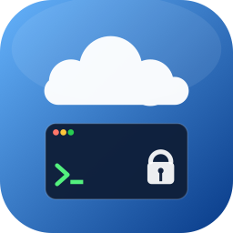

# IAP Desktop Mac

**IAP Desktop Mac** es un cliente nativo de macOS para administrar instancias de
Google Compute Engine a través de [Identity-Aware Proxy
(IAP)](https://cloud.google.com/iap/docs/tcp-forwarding-overview) TCP forwarding,
con paridad funcional con [IAP Desktop](https://github.com/GoogleCloudPlatform/iap-desktop)
(la herramienta oficial para Windows). Sin VPN ni IP pública: el túnel IAP es el
único camino de red hacia las VMs.

<p align="center">
  
</p>

## Qué hace

- **Project Explorer**: árbol Google Cloud → Proyecto → Zona → Instancia, con
  autodiscovery de proyectos (o alta manual) y multi-perfil (varias cuentas/
  proyectos simultáneos, cada uno con su propio Keychain aislado).
- **SSH** sobre el túnel IAP: terminal integrado ([SwiftTerm](https://github.com/migueldeicaza/SwiftTerm)),
  llaves efímeras RSA/ECDSA, OS Login o metadata keys, verificación de host key
  (TOFU) y explorador de archivos SFTP con subida/descarga y arrastrar y soltar.
- **RDP**: fallback vía `.rdp` + "Windows App", reset de credenciales Windows
  por la API de GCE.
- **Diagnóstico**: test de conectividad IAP (permisos IAM, regla de firewall
  `35.235.240.0/20`, probe de WebSocket) y export de logs para soporte.
- **Paneles**: propiedades de instancia, salida de puerto serie, event log
  (Cloud Audit Logs), inventario de paquetes del huésped (guest attributes).
- **Proxy corporativo** y mTLS/BeyondCorp (degradación a endpoint público si no
  hay identidad de dispositivo).

Ver `docs/feature-parity.md` para la matriz completa de paridad funcional con el
original y `docs/adr/` para las decisiones de arquitectura (lenguaje de UI,
transporte del túnel IAP, estrategia RDP).

## Módulos (Swift Package Manager)

| Módulo | Qué es |
|---|---|
| `AuthKit` | OAuth 2.0 instalado (PKCE + loopback), multi-perfil, Keychain, WIF/STS |
| `GCPClient` | REST de Compute, IAP, OS Login, Cloud Logging/Audit Logs |
| `TunnelKit` | Transporte del túnel IAP (WebSocket + relay, SwiftNIO) |
| `SSHKit` | Protocolo SSH sobre el túnel (swift-nio-ssh), llaves efímeras, host keys |
| `SFTPKit` | SFTP v3 sobre la sesión SSH ya autenticada |
| `TerminalUI` | Terminal VT100 (SwiftTerm) conectado al canal SSH |
| `RDPBridge` | Fallback `.rdp` + reset de credenciales Windows |
| `SettingsStore` | Settings jerárquicos (universo → proyecto → zona → instancia) |
| `ExplorerUI` | AppKit: ventana principal, árbol, paneles, menús |
| `App` | Punto de entrada, cableado de todos los módulos |

## Requisitos

- macOS 14+, Xcode 16+ (o CommandLineTools, ver abajo), Swift 6 (concurrencia estricta).
- Una cuenta de Google con acceso a GCP y un **cliente OAuth propio** (ver
  "Login" más abajo) — el repo no incluye ningún client ID ni secret.

## Build

```bash
swift build
```

Compila todos los módulos; el binario queda en `.build/debug/App`. Con
**CommandLineTools sin Xcode completo**, `swift build` funciona directo; para
`swift test` puede hacer falta un workaround puntual (ver abajo).

## Test

```bash
swift test
```

Si ves `TestingMacros plugin not found` (típico con solo CommandLineTools, sin
Xcode completo instalado), usa:

```bash
swift test -Xswiftc -load-plugin-library \
  -Xswiftc /Library/Developer/CommandLineTools/usr/lib/swift/host/plugins/testing/libTestingMacros.dylib
```

Detalle completo del toolchain, troubleshooting y generación de capturas
(`tools/snapshot.sh`) en [`docs/usage.md`](docs/usage.md).

## Instalación (`.app` sin firmar)

```bash
tools/make-app-bundle.sh release
open dist/IAPDesktopMac.app
```

El bundle no está firmado ni notarizado por defecto (ver
`tools/sign-and-notarize.sh` para firmarlo con un certificado Developer ID
propio). Al primer arranque macOS pedirá confirmar que es seguro abrirlo (clic
derecho → **Abrir**, o `xattr -dr com.apple.quarantine dist/IAPDesktopMac.app`).

## Login: usa tu propio cliente OAuth

El repo **no lleva ningún client ID ni client secret embebido** — ni en el
código, ni en `resources/Info.plist` (solo placeholders), ni en el historial de
git. Para iniciar sesión necesitas tu propio cliente OAuth de tipo
**Desktop app**:

1. Crea uno en [Google Cloud Console → Credentials](https://console.cloud.google.com/apis/credentials)
   (scopes `cloud-platform`, `openid`, `email`).
2. Configúralo por **variables de entorno**:

   ```bash
   export GOOGLE_OAUTH_CLIENT_ID="TU_CLIENT_ID.apps.googleusercontent.com"
   export GOOGLE_OAUTH_CLIENT_SECRET="TU_CLIENT_SECRET"
   swift run App
   ```

   o por un **fichero local** (recomendado para el `.app`, que no hereda el
   entorno de la shell): `~/.config/iap-desktop-mac/secrets.env`. Ver la
   sección "Client OAuth: sin secretos en el repo" de
   [`docs/usage.md`](docs/usage.md) para el formato exacto y una tercera
   opción (override desde la propia ventana *Sign In*).

Sin ningún cliente configurado la app sigue funcionando: la ventana *Sign In*
muestra el campo vacío con un enlace a Cloud Console en vez de fallar.

## Contributing

Ver [`CONTRIBUTING.md`](CONTRIBUTING.md). Resumen: metodología spec-driven
(`specs/<área>/{requirements,design,tasks}.md`), PRs pequeños, `swift build` +
`swift test` en verde antes de abrir PR, y **nunca** commitear credenciales
reales (client secrets, tokens, cuentas de servicio).

## Licencia

[Apache License 2.0](LICENSE).

## Relación con el proyecto original

Este proyecto no es un fork ni está afiliado a Google ni al equipo de
[IAP Desktop](https://github.com/GoogleCloudPlatform/iap-desktop); es una
reimplementación nativa para macOS que busca paridad funcional, consultando el
código fuente del original solo como referencia de comportamiento (ver
`docs/feature-parity.md`), no como código a portar línea a línea.
