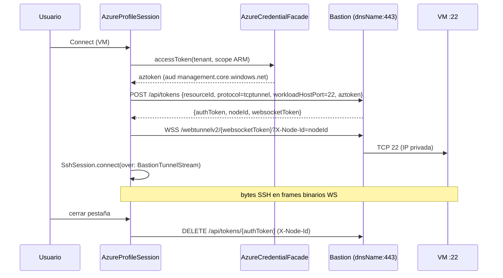

# GH-84 — Investigación: cuentas Azure + SSH/RDP vía Azure Bastion

Fecha: 2026-10-20 · Pedida por el dueño · Estado: **investigación, sin código de producción**.

Código leído como base (solo lectura): `Sources/App/ProfileSession.swift`,
`Sources/App/ProfileCoordinator.swift`, `Sources/AuthKit/{Profiles,KeychainStore,PKCE,LoopbackReceiver,TokenRefresher,CredentialFacade}.swift`,
`Sources/SSHKit/Connect/SshConnector.swift`, `Sources/SSHKit/Session/*`,
`Sources/TunnelKit/{WebSocketTransport,IapListener,RelayStream}.swift`,
`Sources/RDPBridge/{RdpFallbackConnector,WindowsAppLauncher}.swift`,
`Sources/ExplorerUI/ExplorerNode.swift`, `specs/multitenant/*`, `specs/tunnel/transport-decision.md`,
`docs/usage.md` §12 (Sparkle: patrón "secreto fuera del repo, solo en Keychain/secret de CI").

Convención de este documento:

- ✅ **Documentado**: Microsoft Learn / REST reference oficial (URL citada).
- 🔍 **Código fuente oficial, no contrato**: leído en `github.com/Azure/azure-cli-extensions`
  (MIT). Es lo que hace el CLI hoy, pero Microsoft no lo publica como API estable.
- ⚠️ **Inferencia / por validar**: hipótesis nuestra, requiere spike.

---

## 0. Resumen ejecutivo

1. **Auth**: Entra ID con *authorization code + PKCE* y redirect loopback `http://localhost`
   (encaja 1:1 con `AuthorizeURL`/`PKCE`/`LoopbackReceiver` existentes). App registration
   **multi-tenant propia** (no reutilizar el client ID del Azure CLI), *public client*, sin secreto.
   Scope ARM + `offline_access`. Device code solo como fallback opcional: muchas organizaciones
   lo bloquean por Conditional Access y Microsoft recomienda bloquearlo.
2. **Descubrimiento**: ARM REST puro (`/tenants` → `/subscriptions` → VMs/NICs/Bastion hosts),
   paginación por `nextLink`, rol mínimo **Reader**. Resource Graph como optimización.
3. **Bastion**: el *native client* (lo único usable desde una app de escritorio) exige
   **SKU Standard o Premium con `enableTunneling = true`**. Basic no sirve; Developer solo
   desde el portal (y el CLI tiene un camino aparte, no contractual).
4. **Túnel** (protocolo exacto en §3.3, con archivo y línea): **ninguna llamada ARM abre el
   túnel** ni devuelve un `tunnelUri`. ARM solo se usa para leer el Bastion (`dnsName`, SKU,
   `enableTunneling`). El túnel es **plano de datos del Bastion**, todo en `{dnsName}:443`:
   `POST https://{dnsName}/api/tokens` (form-urlencoded, el token ARM va **en el cuerpo**,
   campo `aztoken`) → `{authToken, nodeId, websocketToken}` →
   `wss://{dnsName}/webtunnelv2/{websocketToken}?X-Node-Id={nodeId}` **sin subprotocolo, sin
   Authorization, sin mensaje inicial** → frames binarios = bytes TCP crudos →
   `DELETE https://{dnsName}/api/tokens/{authToken}`. El protocolo **no está documentado** (🔍).
5. **DECISIÓN DEL DUEÑO (2026-10-20): Ruta 1 = túnel nativo en Swift** (`BastionTunnel`).
   La Ruta 2 (delegar en el `az` del usuario) **no se implementa**: queda como **plan B**
   documentado (§3.5), que solo se activa con los disparadores de §3.7.
6. **Limitación crítica de RDP**: el login RDP con **Entra ID vía Bastion no es posible desde
   macOS** — Microsoft solo lo permite con `az network bastion rdp` (Windows-only) y desde PCs
   Windows 10+ unidos/registrados en el mismo directorio (§3.6). Desde Mac: credenciales
   locales/dominio en la VM, o un jump host Windows unido a Entra.
7. **Plan**: spike de protocolo en Swift contra un Bastion real (F0) → auth Entra + árbol
   (F1) → `BastionTunnel` nativo con SSH/SFTP/RDP (F2) → endurecimiento (F3). Plan de
   implementación detallado en §9; equivalencias Swift ↔ `az` en §10.
   Precedente comercial casi idéntico en macOS (TYO Reach, §8).

Veredicto global: **GO** con la Ruta 1, condicionado a que F0 pase sus criterios de aceptación
(detalle en §6.4).

---

## 1. (a) Autenticación Entra ID para app nativa macOS

### 1.1 Authorization code + PKCE vs device code

| | Auth code + PKCE (loopback) | Device code |
|---|---|---|
| Doc | ✅ [v2-oauth2-auth-code-flow](https://learn.microsoft.com/en-us/entra/identity-platform/v2-oauth2-auth-code-flow) | ✅ [v2-oauth2-device-code](https://learn.microsoft.com/en-us/entra/identity-platform/v2-oauth2-device-code) |
| UX | Navegador del sistema, vuelve solo a la app | Copiar código en otra ventana, polling |
| Conditional Access | Normal | Microsoft: *"We recommend organizations get as close as possible to a unilateral block on device code flow"* ✅ [policy-block-authentication-flows](https://learn.microsoft.com/en-us/entra/identity/conditional-access/policy-block-authentication-flows) |
| Reuso en el repo | `PKCE.swift`, `AuthorizeURL.swift`, `LoopbackReceiver.swift`, `LoginSession.swift` | Nada (polling nuevo) |
| Redirect URI | Necesaria (`http://localhost`) | No necesaria |

**Decisión: auth code + PKCE (S256) con loopback**. Device code queda como **fallback manual**
("Iniciar sesión con código") en F1 (§9.1). Se espera que falle en tenants con la política de
CA recomendada por Microsoft, y la UI lo explica en ese caso.

Detalles documentados que afectan al diseño (✅ fuentes arriba y
[reply-url](https://learn.microsoft.com/en-us/entra/identity-platform/reply-url)):

- Endpoints: `https://login.microsoftonline.com/{tenant}/oauth2/v2.0/authorize` y `/token`;
  `{tenant}` ∈ `common | organizations | consumers | <tenant-id>`. Usaremos **`organizations`**
  para el login inicial (las suscripciones Azure viven en tenants de trabajo/escuela) y
  **`<tenant-id>`** para pedir tokens de cada tenant (guest/B2B: *"you must provide the tenant
  identifier to sign them into the resource tenant"*).
- Redirect para apps nativas con navegador del sistema: `http://localhost`. **El puerto se
  ignora en el match** de localhost (RFC 8252 §7.3/§8.3), así que el puerto efímero de
  `LoopbackReceiver` funciona sin registrar N URIs. Microsoft recomienda `127.0.0.1` sobre
  `localhost`, pero para `http://127.0.0.1` hay que editar `replyUrlsWithType` en el manifiesto
  (el portal no lo deja). Registrar **una sola** URI loopback (no varias que difieran solo en puerto).
- Public client: *"Public clients ... must not use secrets or certificates when redeeming an
  authorization code."* → a diferencia del client de Google (que exige `client_secret` en
  Desktop app), en Azure **no hay secreto que custodiar**.
- `response_mode=query` (default para solo `code`); validar `state` (ya lo hace `AuthorizeURL.validate`).

### 1.2 App registration

- Tipo: **Accounts in any organizational directory (multitenant)** (`signInAudience =
  AzureADMultipleOrgs`). Sin cuentas personales MSA (no tienen suscripciones de empresa y además
  cambian reglas de redirect).
- Plataforma: *Mobile and desktop applications* con `http://localhost`;
  *Allow public client flows* = Yes solo si se habilita device code.
- API permission delegada: **Azure Service Management → `user_impersonation`**.
  Todas las operaciones ARM que usamos declaran ese scope (✅ secciones *Security* de cada
  página REST citada en §2).
- Mismo patrón que GCP (`docs/usage.md`, GH-80): **el repo no lleva client ID**; cada usuario
  u organización registra el suyo (o el dueño publica uno para builds oficiales). Un tenant
  con *user consent* deshabilitado requerirá **admin consent** una vez → documentarlo.
- ⚠️ No reutilizar el client ID público del Azure CLI: es una app first-party de Microsoft;
  usarlo desde una app de terceros es suplantación de cliente y puede bloquearse.

### 1.3 Scopes mínimos

```
openid profile offline_access https://management.core.windows.net//user_impersonation
```

- `offline_access` → refresh token (✅: *"Only provided if offline_access scope was requested"*).
- Recurso ARM: el CLI usa **`https://management.core.windows.net//.default`** (doble barra
  intencional) 🔍 [`azure-cli-core/.../auth/util.py#resource_to_scopes`](https://github.com/Azure/azure-cli/blob/dev/src/azure-cli-core/azure/cli/core/auth/util.py)
  + [`cloud.py` `active_directory_resource_id`](https://github.com/Azure/azure-cli/blob/dev/src/azure-cli-core/azure/cli/core/cloud.py).
  ⚠️ En la práctica ARM acepta ambas audiencias (`management.azure.com` y
  `management.core.windows.net`, ambas son identificadores de Azure Service Management),
  pero no encontramos una página que lo garantice. **Bastion valida el `aztoken` que le mandamos; el CLI siempre manda un token con
  audiencia `management.core.windows.net`. Usar exactamente esa audiencia** para no depender
  de que Bastion acepte la otra (validar en el spike F0).

### 1.4 Refresh y varios tenants

- Refresh: `POST /{tenant}/oauth2/v2.0/token` con `grant_type=refresh_token`; **guardar el
  refresh token nuevo que devuelve** (✅: *"Replace the old refresh token with this newly acquired
  refresh token"*). Vida no especificada para nativas → manejar `invalid_grant` /
  `interaction_required` como "requiere Sign In" (igual que `ProfileSession.requiresSignIn`).
- Varios tenants con **una misma cuenta**: tras el login en `organizations`, `GET /tenants`
  lista los tenants del usuario; para cada uno se pide un access token con
  `POST /{tenantId}/oauth2/v2.0/token` + el refresh token. ⚠️ Es lo que hacen MSAL/`az login`
  (multi-resource / cross-tenant refresh); la doc lo enuncia para recursos (*"Refresh tokens are
  valid for all permissions that your client has already received consent for"*), el cruce de
  tenants depende de que la app tenga consentimiento en el tenant destino → si falla con
  `consent_required`/`interaction_required`, interactivo con `{tenant}=<id>` y `login_hint`.
- Caché de access tokens **por (tenantId)** en memoria, 1 h aprox. (`expires_in` 3599).

### 1.5 Varias cuentas a la vez + Keychain aislado

Reutilizar tal cual GH-71/72 (`specs/multitenant/design.md`): **un perfil = una cuenta Azure**
(o una cuenta Google), cada uno con su `ProfileSession`/ventana. Namespacing ya existente:

- Keychain: `ProfileStore.keychainService(for: id, suffix: "azure")` →
  `…profile.<id>.azure`. `ProfileEnvironment.belongs(_:to:)` ya acepta `….profile.<id>.<x>`,
  así que **`purge()` borra también lo de Azure sin cambios** (solo añadir el servicio a
  `knownServices`).
- Cuenta Keychain: `<homeTenantId>:<oid>` (no el UPN: puede cambiar y en B2B es `#EXT#`).
- Guardar solo refresh token + metadatos no sensibles (UPN redactado como hoy
  `ProfileDescriptor.redactedAccount`). Access tokens solo en memoria.
- Alternativa evaluada: **MSAL for iOS/macOS** (`AzureAD/microsoft-authentication-library-for-objc`)
  trae broker/caché/cross-tenant hechos. Contras: dependencia Obj‑C grande, caché propia en
  Keychain con *access group* compartido (choca con el aislamiento por perfil). **Decisión:
  implementación propia sobre AuthKit** (es OAuth estándar; ya tenemos PKCE y loopback).

---

## 2. (b) Descubrimiento ARM REST

Todas con `Authorization: Bearer <token del tenant correcto>`, host `https://management.azure.com`.
Paginación ARM estándar: respuesta `{ "value": [...], "nextLink": "<url absoluta>" }`; seguir
`nextLink` **tal cual** (ya trae `api-version` y `$skiptoken`) hasta que no venga.

| Paso | Request (api-version exacta) | Fuente ✅ |
|---|---|---|
| Tenants | `GET /tenants?api-version=2022-12-01` → `tenantId`, `displayName`, `defaultDomain`, `tenantCategory` (`Home`/`ProjectedBy`/`ManagedBy`) | [tenants/list](https://learn.microsoft.com/en-us/rest/api/resources/tenants/list) |
| Suscripciones | `GET /subscriptions?api-version=2022-12-01` (con token **de ese tenant**) → `subscriptionId`, `tenantId`, `displayName`, `state` | [subscriptions/list](https://learn.microsoft.com/en-us/rest/api/resources/subscriptions/list) |
| Resource groups | `GET /subscriptions/{sub}/resourcegroups?api-version=2021-04-01` (`$filter` por tag, `$top`) | [resource-groups/list](https://learn.microsoft.com/en-us/rest/api/resources/resource-groups/list) |
| VMs (toda la sub) | `GET /subscriptions/{sub}/providers/Microsoft.Compute/virtualMachines?api-version=2026-04-01` (`statusOnly=true` para estado). `osType` en `properties.storageProfile.osDisk.osType`; NICs en `properties.networkProfile.networkInterfaces[].id` | [virtual-machines/list-all](https://learn.microsoft.com/en-us/rest/api/compute/virtual-machines/list-all) |
| Power state | `GET …/virtualMachines/{vm}/instanceView?api-version=2026-04-01` → `statuses[].code == "PowerState/running"` | [virtual-machines/instance-view](https://learn.microsoft.com/en-us/rest/api/compute/virtual-machines/instance-view) |
| NIC (IP privada, subnet→VNet) | `GET …/Microsoft.Network/networkInterfaces/{nic}?api-version=2026-01-01` → `ipConfigurations[].properties.{privateIPAddress, subnet.id}` | [network-interfaces/get](https://learn.microsoft.com/en-us/rest/api/virtualnetwork/network-interfaces/get) |
| Bastion hosts | `GET /subscriptions/{sub}/providers/Microsoft.Network/bastionHosts?api-version=2026-01-01` → `sku.name`, `properties.dnsName`, `enableTunneling`, `enableIpConnect`, `enablePrivateOnlyBastion`, `scaleUnits`, `ipConfigurations[].properties.subnet.id` (Developer: `properties.virtualNetwork.id`) | [bastion-hosts/list](https://learn.microsoft.com/en-us/rest/api/virtualnetwork/bastion-hosts/list) |
| (Opcional, rápido) Resource Graph | `POST /providers/Microsoft.ResourceGraph/resources?api-version=2024-04-01` body `{ "subscriptions": [...], "query": "Resources \| where type =~ 'microsoft.compute/virtualmachines' …" }`, paginación `$skipToken` | [resourcegraph/resources](https://learn.microsoft.com/en-us/rest/api/azureresourcegraph/resourcegraph/resources/resources) |

**Emparejar VM ↔ Bastion** (lógica nuestra): VNet de la VM = prefijo de `subnet.id` de su NIC
hasta `/subnets/`; Bastion candidato = el que vive en esa VNet (prefijo de su
`AzureBastionSubnet`). Bastion en **VNet peered** también alcanza la VM (Basic+; ✅ tabla de
SKUs) → ⚠️ requiere además `GET …/virtualNetworks/{vnet}/virtualNetworkPeerings` (no
verificado en este spike; F1 lo cubre o deja que el usuario elija el Bastion a mano).

### 2.1 RBAC mínimo

✅ [connect-vm-native-client-linux § Required roles](https://learn.microsoft.com/en-us/azure/bastion/connect-vm-native-client-linux):

- **Reader** sobre la VM, **Reader** sobre la NIC con la IP privada, **Reader** sobre el recurso Bastion,
  y **Reader** sobre la VNet de la VM si el Bastion está en una VNet peered
  (✅ [bastion-entra-id-authentication § Assign roles](https://learn.microsoft.com/en-us/azure/bastion/bastion-entra-id-authentication)).
- Solo si se usa login Entra en la VM: **Virtual Machine User Login** o **Virtual Machine Administrator Login**.
- Para descubrimiento basta Reader en sub/RG. Para `run-command` (§4) hace falta
  `Microsoft.Compute/virtualMachines/runCommand/action` (Virtual Machine Contributor o rol custom).

---

## 3. (c) Azure Bastion

### 3.1 SKUs (✅ [bastion-sku-comparison](https://learn.microsoft.com/en-us/azure/bastion/bastion-sku-comparison), [configuration-settings](https://learn.microsoft.com/en-us/azure/bastion/configuration-settings))

| | Developer | Basic | Standard | Premium |
|---|---|---|---|---|
| Subnet `AzureBastionSubnet` /26+ | No | Sí | Sí | Sí |
| IP pública | No | Sí | Sí | No (private-only opcional) |
| **Native client (CLI / nuestra app)** | **No** (portal) | **No** | **Sí** (`enableTunneling`) | **Sí** |
| VNet peering | No | Sí | Sí | Sí |
| Concurrencia | 1 VM a la vez | 40 RDP / 80 SSH (2 inst.) | hasta 1000 RDP / 2000 SSH (50 inst. × 20/40) | ídem |
| Custom port, IP‑connect, file transfer | No | No | Sí | Sí |
| Session recording / private-only | No | No | No | Sí (y recording **no** aplica a native client ✅ [native-client](https://learn.microsoft.com/en-us/azure/bastion/native-client)) |

Consecuencia de producto: la app **solo puede conectar vía Bastion Standard/Premium con
"Native Client Support" activado**. Para Basic/Developer el árbol debe mostrar el Bastion con
el motivo ("SKU sin native client: actualizar a Standard") — mismo comportamiento que el CLI:
🔍 `create_bastion_tunnel` lanza *"Bastion Host SKU must be Standard or Premium and Native Client must be enabled."*

### 3.2 Puertos (corrección al enunciado del issue)

✅ [bastion-nsg](https://learn.microsoft.com/en-us/azure/bastion/bastion-nsg):

- **Cliente → Bastion: solo TCP 443** (`AllowHttpsInbound` desde Internet, o IPs concretas).
  Es lo único que nuestra app necesita salir (igual que IAP: HTTPS + WSS a un host público).
- Bastion → VM: 22 / 3389 (o custom port en Standard+).
- Internos del plano de datos de Bastion: **8080 y 5701** VirtualNetwork↔VirtualNetwork;
  443 a GatewayManager/AzureLoadBalancer/AzureCloud; 80 saliente a Internet.
- **8081 no aparece en la documentación de Bastion** (revisadas NSG, native client, config
  settings) **ni en el código del CLI** (`tunnel.py` solo usa `https://`/`wss://` al puerto por
  defecto 443). El brief del orquestador menciona "443/8081"; lo tratamos como confusión con
  8080 (interno). No afecta al cliente: **solo 443 saliente**.

### 3.2b Matriz oficial de native client (qué comando sirve desde macOS)

✅ [native-client § Connecting to VMs](https://learn.microsoft.com/en-us/azure/bastion/native-client)
+ ✅ [connect-vm-native-client-linux](https://learn.microsoft.com/en-us/azure/bastion/connect-vm-native-client-linux)
+ 🔍 `custom.py` (`_get_ssh_path`: *"Supported platforms: Windows, Darwin, Linux"*;
`_get_rdp_path`: *"Supported platforms: Windows"*):

| Comando | macOS | Entra ID | Sesiones concurrentes | Custom port | Notas |
|---|---|---|---|---|---|
| `az network bastion tunnel` | ✅ | **No** (solo reenvía TCP) | **No** | **No** (según la matriz) | Cualquier cliente nativo (ssh, scp, Windows App) a `127.0.0.1:<port>` |
| `az network bastion ssh --auth-type password\|ssh-key\|AAD` | ✅ (cross-platform) | **Sí** (`AAD`, Linux VM con `AADSSHLoginForLinux`) | Sí | Sí | Lanza el `ssh` del sistema; sin file transfer |
| `az network bastion rdp` | ❌ Windows-only (usa `mstsc`) | Sí (`--enable-mfa`) | Sí | Sí | Inútil en Mac |

Sintaxis exacta del túnel (✅):

```bash
az network bastion tunnel --name "<BastionName>" --resource-group "<ResourceGroupName>" \
  --target-resource-id "<VMResourceId>" --resource-port "<22|3389>" --port "<LocalMachinePort>"
```

IP‑connect (`--target-ip-address` en lugar de `--target-resource-id`): requiere **Standard+**
y activar *IP-based connection*; sin Entra para RDP, sin custom ports
✅ [connect-ip-address](https://learn.microsoft.com/en-us/azure/bastion/connect-ip-address).

### 3.3 Protocolo exacto de `az network bastion tunnel` 🔍

**Dónde está el código.** `az network bastion tunnel|ssh|rdp` **no está en
`github.com/Azure/azure-cli`**: el módulo `network` del core no registra ningún comando
`bastion tunnel/ssh/rdp` (verificado con `grep` sobre
`src/azure-cli/azure/cli/command_modules/network/` en el commit `fa8fb564`). Vive en la
**extensión `bastion`** de `github.com/Azure/azure-cli-extensions` (v1.4.3), que el CLI
instala sola al primer uso. Lo único que aporta `azure-cli-core` es el token ARM.

Permalinks fijados a los commits leídos (2026-10-20):

- `EXT` = `https://github.com/Azure/azure-cli-extensions/blob/3fcfaeb4374d57bbe54b087d7dd35af41a528f85/src/bastion/azext_bastion`
- `CORE` = `https://github.com/Azure/azure-cli/blob/fa8fb564d07b533849f999f061d5102f4644a232/src/azure-cli-core/azure/cli/core`
- `WSC` = `https://github.com/websocket-client/websocket-client/blob/v1.8.0/websocket` (versión fijada por azure-cli: `websocket-client==1.8.0` en `src/azure-cli/requirements.py3.Darwin.txt`)

| Qué | Archivo:líneas |
|---|---|
| Registro de comandos (`tunnel` → `create_bastion_tunnel`) | `EXT/commands.py` L14‑21 |
| Parámetros del comando | `EXT/_params.py` L25‑31, L48‑50 |
| Orquestación del túnel | `EXT/custom.py` L452‑495 |
| Gate de SKU | `EXT/custom.py` L461‑463, L383‑396 |
| IP‑connect | `EXT/custom.py` L373‑380, L465‑472 |
| Endpoint (dnsName vs data pod) | `EXT/custom.py` L416‑422 |
| Listener local | `EXT/custom.py` L431‑438; `EXT/tunnel.py` L41‑66, L116‑127 |
| POST `/api/tokens` | `EXT/tunnel.py` L80‑114 |
| WebSocket | `EXT/tunnel.py` L129‑152 |
| Bombeo WS → TCP | `EXT/tunnel.py` L163‑183 |
| Bombeo TCP → WS | `EXT/tunnel.py` L185‑205 |
| Cierre / DELETE | `EXT/tunnel.py` L155‑159, L210‑230 |
| Developer/QuickConnect data pod | `EXT/developer_sku_helper.py` L9‑29 |
| GET del Bastion por ARM (aaz) | `EXT/aaz/latest/network/bastion/_show.py` L25‑27, L90, L124 |
| Scope del token ARM | `CORE/_profile.py` L141, L379‑388; `CORE/cloud.py` L371; `CORE/auth/util.py` L92‑104 |
| Headers del upgrade WS | `WSC/_handshake.py` L82‑137 |

#### Respuestas concretas a las preguntas del dueño

**(1) ¿Qué llamada ARM abre el túnel? ¿Devuelve `tunnelUri`?**
**Ninguna. No existe `tunnelUri`.** La única llamada ARM es de **lectura**:

```http
GET https://management.azure.com/subscriptions/{sub}/resourceGroups/{rg}/providers/Microsoft.Network/bastionHosts/{name}?api-version=2024-01-01
Authorization: Bearer <token ARM>
```

(`_show.py` L27/L90/L124). De la respuesta se usan `sku.name`, `properties.enableTunneling`,
`properties.enableIpConnect` y `properties.dnsName` (`custom.py` L461‑463, L375, L422).
El "abrir túnel" es el `POST /api/tokens` del paso 3, contra el **plano de datos del Bastion**
(`{dnsName}`), no contra ARM. En Swift podemos usar la api-version más reciente
`2026-01-01` (§2), que devuelve las mismas propiedades.

**(2) ¿Cómo se abre el WebSocket? URL, subprotocolos, headers, primer mensaje.**

Secuencia por **cada conexión TCP aceptada** en el puerto local (`tunnel.py` L129‑136):

**Paso 3: token de sesión** (`tunnel.py` L80‑114):

```http
POST https://{dnsName}/api/tokens HTTP/1.1
Host: {dnsName}
Content-Type: application/x-www-form-urlencoded
X-Node-Id: {nodeId}            ← solo si ya hay uno de una conexión anterior (L93‑96)

resourceId={vmResourceId}&protocol=tcptunnel&workloadHostPort={22|3389|n}&aztoken={accessTokenARM}[&token={authTokenAnterior}][&hostname={ip}]
```

| Campo | Valor | Línea |
|---|---|---|
| `resourceId` | ID ARM completo de la VM. IP‑connect: `/subscriptions/{sub}/resourceGroups/{rg}/providers/Microsoft.Network/bh-hostConnect/{ip}` | L85, `custom.py` L467‑468 |
| `protocol` | literal `tcptunnel` | L86 |
| `workloadHostPort` | puerto de la VM (`--resource-port`) | L87 |
| `aztoken` | **access token ARM en claro, en el cuerpo** | L83, L88 |
| `token` | `authToken` de la respuesta anterior; **se omite** en la primera (requests descarta valores `None`: `requests/models.py` v2.32.3 L125) | L89 |
| `hostname` | solo IP‑connect: la IP destino | L91‑92 |

- Sin `Authorization`; `requests` añade sus headers por defecto (`User-Agent: python-requests/…`, `Accept: */*`).
- **200** → JSON `{"authToken": "...", "nodeId": "...", "websocketToken": "..."}` (L112‑114).
  **≠200** → `HttpResponseError` con `response_json["message"]` si viene (L107‑110).

**Paso 4: WebSocket** (`tunnel.py` L136‑142):

```
wss://{dnsName}/webtunnelv2/{websocketToken}?X-Node-Id={nodeId}
```

Headers del upgrade, tal como los genera `websocket-client` 1.8.0 sin opciones extra
(`_handshake.py` L85‑123):

```http
GET /webtunnelv2/{websocketToken}?X-Node-Id={nodeId} HTTP/1.1
Upgrade: websocket
Host: {dnsName}
Origin: https://{dnsName}
Sec-WebSocket-Key: <aleatoria>
Sec-WebSocket-Version: 13
Connection: Upgrade
```

- **Sin `Sec-WebSocket-Protocol`**: `create_connection` no recibe `subprotocols`.
- **Sin `Authorization`** ni cookies del POST: son librerías distintas (`requests` vs
  `websocket-client`), así que no hay sesión HTTP compartida. La afinidad la dan `nodeId` en
  la query y el `websocketToken` en el path.
- Socket con `TCP_NODELAY=1` y verificación TLS `CERT_REQUIRED` (L138‑141).
- **Sin mensaje inicial ni handshake aplicativo.** Destino, puerto e identidad quedaron
  fijados en el servidor durante el POST. El `websocketToken` del path es la credencial de un
  solo uso. Tras el `101 Switching Protocols` se pasa directamente a bytes del protocolo de
  la VM; con SSH, lo primero que llega es el banner `SSH-2.0-…` del servidor.
- Developer/QuickConnect: `wss://{dataPod}/omni/webtunnel/{websocketToken}`, sin `X-Node-Id`
  (L132‑134). `dataPod` se obtiene con `POST https://{dnsName}/api/connection` en JSON
  `{resourceId, bastionResourceId, vmPort, azToken, connectionType:"nativeclient"}`
  (`developer_sku_helper.py` L15‑29). **El comando `tunnel` rechaza Developer** (gate L461‑463:
  solo Standard/Premium); solo `ssh` lo admite (L183, L391‑393). Fuera de alcance.

**(3) Formato del tráfico y cierre.**

- **TCP → WS** (`tunnel.py` L187‑195): lee hasta **4096 B** del socket local y envía un frame
  **binario** (opcode `0x2`, `send_binary`) por lectura. Sin cabecera, longitud ni ACK propios.
- **WS → TCP** (L167‑173): cada mensaje recibido se escribe tal cual al socket local. Se
  esperan frames binarios: un frame de texto llegaría como `str` y `socket.send` fallaría, así
  que en la práctica el servidor solo envía binario.
- **Keepalive**: el CLI no envía pings (`create_connection` sin `ping_interval`). Sí responde
  con pong a los pings del servidor (comportamiento estándar de `websocket-client`).
- **Cierre**:
  - EOF local (`recv_into` = 0) → cierra socket y WS (Close 1000) (L197‑205).
  - Close o mensaje vacío del WS → cierra el socket local (L175‑183).
  - Cuando no queda ninguna conexión activa → `DELETE https://{dnsName}/api/tokens/{authToken}`
    con `X-Node-Id`. 200/204 = OK, **404 = sesión ya borrada** (L155‑159, L210‑228).
  - Ctrl+C → `cleanup()` (`custom.py` L445‑449, L489).
- **No hay** SID, ACK, reconexión ni reanudación, a diferencia del relay IAP (`SshRelayFormat`).
  Si el WS cae, la conexión TCP muere y hay que repetir POST + WS.

**(4) ¿Token ARM en query string o header?**
**En ninguno de los dos: va en el cuerpo form-urlencoded del `POST /api/tokens`, campo
`aztoken`** (L88). Ni la query ni los headers del WS llevan token ARM. La query solo lleva
`X-Node-Id` (no es secreto) y el path el `websocketToken` (sí es secreto, de un solo uso, nunca
se registra en logs). El token se pide con scope `https://management.core.windows.net//.default`
(`_profile.py` L141 y L388 → `cloud.py` L371 → `auth/util.py` L104).

**(5) Puertos y hosts: 443 vs 8081.**

| Host | Puerto | Para qué |
|---|---|---|
| `login.microsoftonline.com` | 443 | Tokens Entra |
| `management.azure.com` | 443 | ARM (descubrimiento + GET del Bastion) |
| `{dnsName}` (p. ej. `bst-<guid>.bastion.azure.com`) | **443** | `POST/DELETE /api/tokens` y `wss://…/webtunnelv2/…` (URLs sin puerto explícito, L99/L136/L219) |
| `127.0.0.1` | efímero (`--port`, 0 = auto, `custom.py` L434‑436) | Listener local (CLI) |

**8081 no aparece** en el código de la extensión (`grep` de `8081` en `azext_bastion/` sin
resultados) **ni en la documentación**. El único `8080` es un ejemplo de reenvío `-L` en
`_help.py` L29. **No hay ningún caso en que el cliente use otro puerto que 443.** 8080 y 5701
son puertos internos entre instancias de Bastion ✅ [bastion-nsg](https://learn.microsoft.com/en-us/azure/bastion/bastion-nsg).

#### Diferencias con IAP (lo que ya tenemos)

| | IAP (TunnelKit hoy) | Bastion |
|---|---|---|
| Auth | `Authorization: Bearer` en el upgrade | Token ARM en el cuerpo del POST previo; WS autorizado por path |
| Subprotocolo | `relay.tunnel.cloudproxy.app` | ninguno |
| Framing | `SshRelayFormat` (tags, ACK, SID, reconnect) | ninguno (binario crudo) |
| Paso previo | — | `POST /api/tokens` (+ `DELETE` al cerrar) |
| Reconexión | sí (SID + ack) | no |

Nota sobre la matriz de §3.2b: la doc dice "Custom port: No" para `tunnel`, pero el código solo
restringe el puerto en IP‑connect (`custom.py` L470‑472). Con `--target-resource-id` cualquier
`--resource-port` llega al servidor. ⚠️ Lo validamos en el spike F0.

### 3.4 ¿Implementable en Swift? Sí — y mejor que el CLI para SSH

- **SSH sin puerto local**: `SshSession.connect(over: SshByteStream, …)` ya acepta cualquier
  stream de bytes. Un `BastionTunnelStream: SshByteStream` (POST token + WSS binario) permite
  SSH **in-process**, igual que hoy con `RelayStream`, sin exponer un puerto en localhost.
  SFTP (`SFTPKit`) funciona encima sin cambios.
- **RDP**: `IapListener.start(streamFactory:)` (listener loopback que ya valida que el cliente
  sea local) + factory que abre un `BastionTunnelStream` por conexión → `.rdp` a
  `127.0.0.1:<puerto>` → Windows App (`RDPBridge` sin cambios). Nota 🔍: `az network bastion rdp`
  **solo funciona en Windows** (`_get_rdp_path` → *"Supported platforms: Windows"*), así que en
  macOS el único camino es tunnel + cliente RDP propio, que es justo lo que hace `RDPBridge`.
- **Qué es inestable** (⚠️): rutas `/api/tokens`, `/webtunnelv2/`, `/omni/webtunnel/`,
  `/api/connection`, nombres de campos y semántica de `X-Node-Id` **no están en Microsoft
  Learn ni en la REST reference**. Han cambiado antes (la extensión pasó por "bug fixes for
  tunnel" en 1.3.0 y 1.4.2). Mitigación con la Ruta 1 elegida:
  - errores tipados (`BastionTunnelError.protocolChanged`);
  - test de contrato e2e contra un Bastion real antes de cada release (§9.5);
  - vigilar `azure-cli-extensions/src/bastion/HISTORY.rst` en cada release del CLI;
  - plan B (§3.5) **listo en papel**, sin implementar.
- **Elección de librería WebSocket**: **SwiftNIO + WebSocketKit** (`NIOWebSocketTransport`
  existente, parametrizado). `URLSessionWebSocketTask` sería técnicamente suficiente porque
  Bastion no pide subprotocolo ni headers especiales, pero NIO ya está probado, soporta proxy
  CONNECT (`ProxyConfig`) y lo cubren los tests de TunnelKit.
  `Origin: https://{dnsName}` se replica a mano para igualar exactamente al CLI.
- **Listener local** (RDP, y opcionalmente `ssh`/`scp` externos): `Network.framework`
  `NWListener` en `127.0.0.1`, que ya existe como `IapListener` (valida que el cliente sea
  loopback y cuenta estadísticas). Se reutiliza con otro `StreamFactory`.
- Licencia: la extensión es MIT; reimplementar el protocolo (no copiar código) es compatible
  con Apache‑2.0. Citar la fuente en el código.

### 3.5 Plan B (no se implementa salvo disparador): delegar en el `az` del usuario

> Por decisión del dueño, esta ruta **no forma parte del plan**. Se documenta para poder
> activarla rápido (≈ 4–5 d) si se cumple algún disparador de §3.7.

Lo único **documentado** para clientes no Windows es `az network bastion tunnel` ✅
([native-client § Connecting to VMs](https://learn.microsoft.com/en-us/azure/bastion/native-client)):

```bash
az network bastion tunnel --name <bastion> --resource-group <rg> \
  --target-resource-id <vmResourceId> --resource-port 22 --port <puertoLocal>
```

Diseño del fallback (`AzCliBastionTunnel`):

1. Detectar `az` (`/opt/homebrew/bin/az`, `/usr/local/bin/az`, `PATH` del login shell) y versión
   (`az version -o json`; requisito ✅ CLI ≥ 2.32, file transfer ≥ 2.62). La extensión `bastion`
   se instala sola al primer uso.
2. La sesión del CLI es **la del usuario** (`az login`), no la de nuestro perfil: comprobar con
   `az account show` que el tenant coincide; si no, `--subscription <id>` en el comando.
   El token **nunca** pasa por nuestra app.
3. Elegir puerto libre (bind :0 y soltar), lanzar `Process` con argumentos (sin shell), esperar a
   que el puerto acepte conexión (stdout imprime *"Tunnel is ready, connect on port …"*), conectar:
   - SSH: nuestro `SshSession` sobre un `NWConnection` a `127.0.0.1:<port>` (mismo terminal/SFTP).
   - RDP: `.rdp` → Windows App.
4. Al cerrar la pestaña: `SIGINT` al proceso (el CLI hace `cleanup()` = `DELETE /api/tokens`).
5. Sandbox: la app no está sandboxed hoy (bundle sin firmar, `tools/make-app-bundle.sh`) → `Process` OK.
6. Variante para **SSH con Entra** (única vía documentada desde Mac): `az network bastion ssh
   --auth-type AAD` lanza el `ssh` del sistema, así que no se puede montar sobre nuestro
   `SshSession`; requiere una pestaña de terminal **de proceso local** (SwiftTerm
   `LocalProcessTerminalView`) que ejecute el comando. Sin SFTP integrado en ese modo.

### 3.6 Limitación crítica: RDP con Entra ID desde macOS

✅ [bastion-entra-id-authentication § Limitations](https://learn.microsoft.com/en-us/azure/bastion/bastion-entra-id-authentication):

- *"For native client RDP connections, remote connection to virtual machines joined to Microsoft
  Entra ID is allowed only from Windows 10 or later PCs that are Microsoft Entra registered,
  Microsoft Entra joined, or Microsoft Entra hybrid joined to the same directory as the virtual machine."*
- El único comando native client con Entra para RDP es `az network bastion rdp --enable-mfa`,
  que es Windows-only (§3.2b).
- RDP con Entra **en el portal** (navegador) existe pero está en *public preview* y no es native client.
- El brief del orquestador cita además un Q&A oficial (2026‑03) según el cual el cliente macOS
  no completa NLA/CredSSP con Entra. **No pudimos localizar ese hilo**; el hilo de Q&A de
  2026‑03 encontrado ([answers/a/12645110](https://learn.microsoft.com/answers/a/12645110)) trata
  de la opción Entra oculta en el portal, no de macOS. La conclusión se sostiene igualmente con
  la doc oficial citada arriba.

**Consecuencias de diseño**:

1. RDP desde la app = túnel (a o b) + Windows App con **credenciales locales o de dominio AD**
   de la VM (igual que hoy en GCP con `RDPBridge` + reset de credenciales).
2. Para VMs **solo Entra-joined** sin cuenta local: ofrecer "reset de contraseña local" vía
   extensión VMAccess / `runCommand` (F4) o documentar el jump host Windows unido a Entra.
3. El árbol debe avisar: "Entra RDP no disponible desde macOS" cuando la VM tenga la extensión
   `AADLoginForWindows` (visible en `instanceView.extensions`).
4. SSH con Entra **sí** es posible desde Mac, pero solo vía `az network bastion ssh --auth-type AAD` (§3.5 punto 6).

### 3.7 Dos caminos de transporte: (a) nativo Swift vs (b) `az` delegado

| | **(a) Túnel nativo Swift** | **(b) Delegar en `az` del usuario** |
|---|---|---|
| Base | Reimplementar 🔍 `POST /api/tokens` + `wss://{dnsName}/webtunnelv2/…` (443) | ✅ `az network bastion tunnel` / `ssh` documentados |
| Contrato | **Ninguno**: puede romperse sin aviso | Soportado por Microsoft |
| Requisitos usuario | Ninguno extra | Azure CLI ≥ 2.32 (+ extensión `bastion`, auto) y `az login` **aparte** |
| Identidad | La del perfil de la app (multi-cuenta real, Keychain aislado) | La sesión global de `az` (una "cuenta activa"; choca con multi-perfil, mitigable con `--subscription` y `AZURE_CONFIG_DIR` por perfil ⚠️) |
| SSH | In-process sobre `SshSession` (terminal + SFTP integrados, sin puerto local) | Por puerto local `127.0.0.1` → `SshSession` igualmente (o `ssh` del sistema para Entra) |
| RDP | `IapListener` + Windows App | Puerto del `az` + Windows App |
| Entra SSH | No (requeriría el flujo de certificados `az ssh cert`, no documentado) | **Sí** (`--auth-type AAD`) |
| Entra RDP desde Mac | No (limitación de plataforma, §3.6) | No (igual) |
| Superficie / mantenimiento | ~600–900 LOC + mock server + test de contrato | ~300 LOC (detección, proceso, puertos, errores) |
| UX | Óptima (sin dependencias) | Aceptable (instalar CLI, login doble) |

**Decisión (dueño, 2026-10-20): Ruta 1 = (a) túnel nativo Swift.**

- **(a) nativo Swift — GO, ruta principal y única implementada.** Condición de entrada: el
  spike F0 (§9.6) debe pasar sus criterios. Si F0 falla por R2 (Bastion rechaza tokens de
  nuestra app registration), se vuelve al dueño con evidencia antes de seguir.
- **(b) `az` delegado — NO-GO para implementar ahora; plan B.** Disparadores para activarlo:
  1. F0 demuestra que Bastion no acepta tokens de una app registration de terceros;
  2. en producción, un cambio de protocolo rompe (a) y el arreglo tarda más de una release;
  3. hace falta SSH con Entra (`--auth-type AAD`), que solo es viable vía `az` (§3.5 punto 6).
- Mientras tanto, la UI no menciona el CLI. El error `protocolChanged` muestra "Bastion cambió
  su protocolo; actualiza la app" y registra en el log el status y la versión observada.

---

## 4. (d) Alternativas

| Opción | Cómo | Pros | Contras | Veredicto |
|---|---|---|---|---|
| **Azure Arc + SSH** ✅ [ssh-arc-overview](https://learn.microsoft.com/en-us/azure/azure-arc/servers/ssh-arc-overview) | Agente Arc (≥1.31) en la máquina, RP `Microsoft.HybridConnectivity`, endpoint `…/providers/Microsoft.HybridConnectivity/endpoints/default?api-version=2023-03-15`, `az ssh arc` | Sin IP pública ni puertos; sin coste de Bastion; RDP sobre SSH | Pensado para **servidores Arc-enabled** (on‑prem/otras nubes), no para VMs Azure nativas; requiere **Owner/Contributor**; proxy de conexión es binario cerrado (`az ssh` descarga un `sshProxy`) | NO-GO ahora (otro producto); reevaluar si el dueño tiene parque Arc |
| **VPN punto a sitio** | VPN Gateway + Azure VPN Client (macOS) | Acceso de red completo, cualquier cliente | Infra aparte, coste fijo (VpnGw1 **$0.19/h** + $0.01/conexión‑h en eastus, Retail Prices API), fuera del alcance de la app | Fuera de alcance: la app funcionaría "directo a IP privada" sin cambios de túnel |
| **`az vm run-command` / REST** ✅ [virtual-machines/run-command](https://learn.microsoft.com/en-us/rest/api/compute/virtual-machines/run-command) | `POST …/virtualMachines/{vm}/runCommand?api-version=2026-04-01` `{commandId: "RunShellScript"\|"RunPowerShellScript", script:[…]}` → 202 + `Location`/`Retry-After` | Sin red hacia la VM; útil para diagnóstico y para **inyectar una llave SSH efímera** (equivalente a "metadata keys" de GCP) | No interactivo, lento (decenas de s), requiere `runCommand/action` | **GO como complemento** (fase 4: "reset credenciales"/llave efímera), no como transporte |
| **Jump host propio** | VM con IP pública + `ProxyJump` | Barato, estándar | Superficie expuesta, gestión de llaves; es justo lo que Bastion evita | Soportable "gratis" si la app admite SSH a IP/host arbitrario (fuera de GH-84) |
| **Microsoft Entra Private Access** ✅ [concept-private-access](https://learn.microsoft.com/en-us/entra/global-secure-access/concept-private-access), [cliente macOS](https://learn.microsoft.com/en-us/entra/global-secure-access/how-to-install-macos-client) | ZTNA de Microsoft (Global Secure Access): cliente en el Mac + *private network connector* en la VNet; Quick Access por FQDN/IP con Conditional Access | Sin IP pública ni Bastion; CA/MFA por app; cliente macOS (macOS 14+) | Licencia Entra Suite/Private Access; el Mac debe estar **registrado en el tenant vía Company Portal**; despliegue MDM; es red, no gestión de VMs | Fuera de alcance; si el cliente lo tiene, la app conecta "directo a IP privada" (modo futuro *Direct*) |
| **Tailscale / NetBird (self-hosted)** — [Tailscale subnet routers](https://tailscale.com/kb/1019/subnets), [NetBird routing](https://docs.netbird.io/how-to/routing-traffic-to-private-networks) | Un nodo *subnet router / routing peer* en la VNet anuncia sus rangos al mesh WireGuard | Muy barato (una VM pequeña), multi-nube, buena UX en Mac | Infra y política propias; NetBird marca *Routes* como deprecado en favor de *Networks*; identidad no ligada a RBAC de Azure | Fuera de alcance; mismo modo *Direct* que VPN/Private Access |

Las cuatro opciones de red (VPN P2S, Private Access, Tailscale/NetBird, jump host) comparten
una conclusión: **no necesitan código de túnel en la app**; bastaría un modo de conexión
"Direct (IP privada alcanzable)" — issue aparte, barato, independiente de Bastion.

---

## 5. (e) Diseño propuesto

### 5.1 Principio

Igual que GH-72: **composición, no reescritura**. Un perfil Azure es otro `ProfileSession`
con su propio grafo de objetos. SSH/SFTP/terminal/RDP se reutilizan; cambia el
*proveedor de identidad*, el *descubrimiento* y el *transporte*.

```mermaid
flowchart TB
  PC[ProfileCoordinator] -->|provider = .gcp| PS[ProfileSession GCP<br/>existente]
  PC -->|provider = .azure| APS[AzureProfileSession<br/>nuevo]

  subgraph AuthKit
    EAuth[EntraAuthorizer<br/>PKCE + LoopbackReceiver]
    ECred[AzureCredentialFacade<br/>refresh por tenant]
    KC[(Keychain<br/>…profile.&lt;id&gt;.azure)]
  end
  APS --> ECred
  ECred --> EAuth
  ECred --> KC

  subgraph AzureClient [AzureClient (nuevo módulo)]
    ARM[ArmClient<br/>paginación nextLink]
    DISC[AzureDiscovery<br/>tenants→subs→VMs/NICs/Bastions]
  end
  APS --> DISC --> ARM

  subgraph BastionKit [BastionKit (nuevo, depende de TunnelKit)]
    BSC[BastionSessionClient<br/>POST/DELETE /api/tokens]
    BT[BastionTunnelStream<br/>WSS binario]
    FWD[BastionLocalForwarder<br/>NWListener 127.0.0.1]
  end
  APS --> BT
  BT --> BSC
  BT --> WS[NIOWebSocketTransport<br/>TunnelKit existente]

  APS --> SSH[SshSession / SFTPKit / TerminalUI<br/>existentes]
  SSH -. SshByteStream .-> BT
  APS --> FWD --> RDP[RDPBridge → Windows App]
  FWD -. un BastionTunnelStream por conexión .-> BT
  CLI[(Plan B: AzCliBastionTunnel<br/>no implementado)]:::planb
  classDef planb stroke-dasharray: 5 5

  APS --> UI[ExplorerWindowController<br/>dataSourceLabel: Azure]
```

### 5.2 Secuencia de conexión SSH nativa



### 5.3 Bocetos de tipos Swift (no es código de producción)

```swift
// AuthKit — perfil con proveedor (cambio mínimo en ProfileDescriptor, retrocompatible:
// ausencia del campo = .gcp).
public enum CloudProvider: String, Codable, Sendable { case gcp, azure }

public struct EntraClientConfig: Sendable, Equatable {
    public var clientID: String              // app registration propia, sin secreto
    public var authority = URL(string: "https://login.microsoftonline.com")!
    public var loginTenant = "organizations"
    public static let armScope = "https://management.core.windows.net//user_impersonation"
}

/// Credencial persistida (Keychain …profile.<id>.azure). Access tokens solo en memoria.
public struct AzureOfflineCredential: Codable, Sendable {
    public var homeTenantID: String
    public var objectID: String              // oid: clave estable de cuenta
    public var username: String              // UPN, solo para mostrar (redactado en índice)
    public var refreshToken: String
}

public actor AzureCredentialFacade {
    public func signIn(using launcher: LoginSession) async throws -> AzureOfflineCredential
    /// Token ARM para un tenant concreto; refresca y rota el refresh token.
    public func accessToken(tenantID: String) async throws -> String
    public func signOut() async throws
}
```

```swift
// AzureClient — descubrimiento ARM puro, testeable con URLProtocol mock.
public struct AzureVM: Sendable, Hashable, Identifiable {
    public var id: String                    // resource ID ARM
    public var name, resourceGroup, subscriptionID, tenantID, location: String
    public var os: InstanceOS                // reutiliza el enum de ExplorerUI
    public var powerState: String?           // "PowerState/running"
    public var privateIP: String?
    public var vnetID: String?
}

public struct AzureBastion: Sendable, Hashable {
    public enum SKU: String, Sendable { case developer = "Developer", basic = "Basic",
                                         standard = "Standard", premium = "Premium" }
    public var id: String
    public var sku: SKU
    public var dnsName: String
    public var tunnelingEnabled: Bool
    public var vnetID: String?
    public var supportsNativeClient: Bool { (sku == .standard || sku == .premium) && tunnelingEnabled }
}

public struct ArmClient: Sendable {
    public init(token: @escaping @Sendable (_ tenantID: String) async throws -> String)
    /// Sigue `nextLink` hasta agotar; tipado por página `{value, nextLink}`.
    public func list<T: Decodable & Sendable>(_ path: String, apiVersion: String, tenantID: String) async throws -> [T]
}
```

```swift
// BastionKit — transporte.
public struct BastionTarget: Sendable, Hashable {
    public var bastion: AzureBastion
    public var vmResourceID: String
    public var port: UInt16                  // 22 / 3389 / custom
    public var tenantID: String
}

public enum BastionTunnelError: Error, Sendable, Equatable {
    case nativeClientDisabled(sku: String)   // Basic/Developer o enableTunneling=false
    case unauthorized(message: String?)      // 401/403 de /api/tokens (RBAC: Reader VM/NIC/Bastion)
    case protocolChanged(status: Int)        // respuesta inesperada → fallback CLI
    case cliNotFound, cliFailed(exitCode: Int32)
}

/// Implementación nativa (🔍 protocolo no contractual). Conforma SshByteStream.
public actor BastionTunnelStream: SshByteStream {
    public static func connect(to target: BastionTarget,
                               token: @Sendable () async throws -> String,
                               opener: any RelayChannelOpening) async throws -> BastionTunnelStream
    public func close() async               // DELETE /api/tokens/{authToken}
}

// (Ruta 1: sin selector de transporte. Si se activa el plan B, se introduce aquí un
//  `BastionTransportSelector` que envuelva `BastionTunnelStream` y `AzCliBastionTunnel`.)
```

```swift
// App — análogo a ProfileSession (mismas responsabilidades de ventana/pestañas).
@MainActor
final class AzureProfileSession: NSObject {
    let id: ProfileID
    let environment: ProfileEnvironment
    let credentials: AzureCredentialFacade
    private lazy var discovery = AzureDiscovery(arm: ArmClient(token: { try await self.credentials.accessToken(tenantID: $0) }))
    private lazy var tunnels = BastionTunnelFactory(/* token ARM por tenant, opener NIO, proxy */)
    private var sshSessions: [String: SshSession] = [:]       // igual que ProfileSession
    private var terminalTabs: TerminalTabManager?
    func openWindow()                                          // ExplorerWindowController(dataSourceLabel: "Azure")
    func teardown() async                                      // cierra túneles (DELETE tokens) y sesiones
}
```

Para no duplicar `ProfileSession` (622 líneas), F1 debe extraer un protocolo
`ProfileSessionHosting` (ventana, pestañas, cierre, Settings) que ambos implementen;
`ProfileCoordinator` pasa a `ProfileSessionRegistry<any ProfileSessionHosting>`.

### 5.4 Árbol Explorer

Hoy `ExplorerNode` es `cloud → project → zone → instance` (GCP). Propuesta: una ventana por
perfil (REQ-MT-2 sigue igual), así que **una ventana Azure muestra solo el árbol Azure**:

```
Microsoft Azure                (cloud: tenants, VMs)
└─ Contoso (tenant)            (tenant: defaultDomain, categoría)
   └─ Producción (suscripción)
      └─ rg-web (resource group)
         ├─ vm-web-01  🐧 running   Bastion: bst-hub (Standard) ✓
         └─ vm-sql-01  🪟 running   Bastion: — (SKU Basic: sin native client)
```

```swift
public enum ExplorerNode: Hashable, Sendable {
    case cloud(projectCount: Int, instanceCount: Int)
    case project(ProjectInfo)
    case zone(ZoneInfo)
    case instance(InstanceInfo)
    // nuevos (GH-84 F1)
    case azureCloud(tenantCount: Int, vmCount: Int)
    case azureTenant(AzureTenantInfo)
    case azureSubscription(AzureSubscriptionInfo)
    case azureResourceGroup(AzureResourceGroupInfo)
    case azureVM(AzureVMInfo)          // properties: SKU/estado del Bastion asociado
}
```

Menú contextual de `azureVM`: *Connect* (SSH si Linux, RDP si Windows), *Browse files* (SFTP),
*Properties*. Sin "Serial port", "Event log" ni "Inventory" en F1 (equivalentes Azure:
boot diagnostics, Activity Log — fuera de alcance).

### 5.5 Credenciales de la VM (SSH/RDP)

Bastion transporta bytes; **la autenticación SSH/RDP sigue siendo con la VM**:

- F2/F3: llave SSH local del usuario o usuario/contraseña (Keychain por perfil, reutiliza
  `KeychainSettingsStore`), host key TOFU (`InMemoryKnownHosts` → T-SSH-7).
- RDP: usuario/contraseña **local o de dominio AD** en el `.rdp`. **No Entra** desde macOS (§3.6).
- F4 (NO-GO por ahora): login Entra SSH (certificado de `az ssh cert` 🔍, no documentado como
  REST) y llave efímera vía `runCommand` (✅ documentado, pero lento).

---

## 6. (f) Riesgos, costos, límites y plan

### 6.1 Riesgos

| # | Riesgo | Prob. | Impacto | Mitigación |
|---|---|---|---|---|
| R1 | Protocolo `/api/tokens` + `/webtunnelv2` cambia (no documentado 🔍) | Media | Alto (túnel nativo roto; es la única ruta) | Test e2e de contrato antes de cada release (§9.5); vigilar `HISTORY.rst` de la extensión; error `protocolChanged` explícito; plan B listo en papel (§3.5, ≈ 4–5 d) |
| R2 | Bastion rechaza tokens de nuestra app registration (audiencia/appid) ⚠️ | Baja‑media | Bloqueante para la Ruta 1 | Spike F0 antes de invertir; usar audiencia `management.core.windows.net`; si falla → escalar al dueño (disparador 1 del plan B) |
| R3 | Clientes con Basic/Developer (sin native client) | Alta | Funcionalidad nula para ellos | Mensaje claro en el árbol; doc de upgrade ✅ [upgrade-sku](https://learn.microsoft.com/en-us/azure/bastion/upgrade-sku) |
| R4 | Tenants con user consent deshabilitado | Alta en empresas | Login falla con `consent_required` | Documentar admin consent URL; mensaje específico |
| R5 | Conditional Access (MFA, device compliance, token protection) | Media | Login/refresh falla | Navegador del sistema (cumple MFA); errores `interaction_required` → re-login; no usar device code |
| R6 | Coste: Bastion cobra por hora desde que existe, no por uso | Cierta | Coste para el dueño/clientes y para nuestras pruebas | Pruebas con despliegue efímero (crear → probar → borrar, ~10 min de deploy) |
| R7 | Peering/hub‑spoke: emparejar VM↔Bastion mal | Media | Botón Connect deshabilitado erróneamente | Selector manual de Bastion por VM, recordado en settings |
| R8 | Duplicación de `ProfileSession` | Media | Deuda | Extraer `ProfileSessionHosting` en F1 |
| R9 | Secretos en tránsito/logs: `aztoken` en el cuerpo del POST, `websocketToken` en el path del WS | Media | Fuga de credenciales en logs | `description` redactado (como `SshConnector`); nunca registrar URLs del WS; tests que verifiquen la redacción |
| R10 | Sesión larga (> vida del access token ≈ 1 h) | Media | Desconexión a mitad de sesión | Medir en F0; si el servidor corta, re‑POST con `token` + `X-Node-Id` y aviso en la pestaña (F3) |

### 6.2 Costo por hora de Bastion por SKU

Fuente: **Azure Retail Prices API** (oficial), `serviceName eq 'Azure Bastion'`, región
`eastus`, pay‑as‑you‑go, consultada 2026‑10‑20:
`https://prices.azure.com/api/retail/prices?$filter=serviceName eq 'Azure Bastion' and armRegionName eq 'eastus'`
(la página [pricing](https://azure.microsoft.com/en-us/pricing/details/azure-bastion/) renderiza
los importes por JS).

| SKU | USD/hora (base, 2 instancias) | Instancia adicional | ≈ USD/mes (730 h) | Native client |
|---|---|---|---|---|
| Developer | **gratis** | — | 0 | No |
| Basic | **0.19** | — (fijo 2) | ≈ 138.70 | No |
| Standard | **0.29** | 0.14 | ≈ 211.70 | **Sí** |
| Premium | **0.45** | 0.22 | ≈ 328.50 | **Sí** |

- Datos salientes: primeros **5 GB/mes gratis**, luego ≈ **$0.087/GB** (tramos menores a partir de 10 TB).
- Varía por región: Standard entre **$0.29 y $0.362/h** según la región (misma API, todas las regiones).
- ✅ *"Hourly pricing starts from the moment that Bastion is deployed, regardless of outbound data usage."*
- Coste mínimo realista para usar la app con Bastion: **Standard ≈ $212/mes por VNet hub**
  (un Bastion sirve VMs de VNets peered).

### 6.3 Límites relevantes

- Por instancia: 20 RDP + 40 SSH concurrentes; Standard/Premium 2–50 instancias ✅.
- Developer: 1 VM a la vez, sin peering, regiones limitadas ✅ (y sin native client).
- Native client: sin session recording; IP‑connect sin Entra ni custom port ✅.
- Tunnel: en la tabla oficial "Concurrent VM sessions: No" para `tunnel` ✅ → **un túnel por
  VM**; nuestro diseño abre un `BastionTunnelStream` por pestaña, que es lo correcto.
- Tokens Entra: access ≈ 1 h; el túnel solo usa el `aztoken` al abrir (POST); ⚠️ por validar
  si una sesión WS larga sobrevive a la expiración del token (en el CLI nada lo renueva).

### 6.4 Plan por fases (esfuerzo en días‑persona, 1 dev que conoce el repo)

| Fase | Contenido | Esfuerzo | Depende de | Veredicto |
|---|---|---|---|---|
Ruta 1 (túnel nativo Swift) fijada por el dueño. Criterios de aceptación detallados en §9.6.

| Fase | Contenido | Esfuerzo | Depende de | Veredicto |
|---|---|---|---|---|
| **F0 — Spike de protocolo en Swift** | `Spikes/BastionSpike` (ejecutable SwiftPM fuera de `Sources/`): token Entra con **nuestra** app registration → GET Bastion → `POST /api/tokens` → WSS → listener local → `ssh -p` y Windows App reales; `DELETE` al cerrar. Medir: aceptación del token (R2), custom port, sesión > 1 h, cierre. | 2–3 d + ~3 h de Bastion Standard (≈ $1) | Suscripción de prueba del dueño | **GO** (hacerlo ya; decide todo lo demás) |
| **F1 — AzureAuth + AzureARMClient + árbol** | §9.1, §9.2, §9.4 (parte UI read‑only). 100 % API documentada. | 7–10 d | — (en paralelo a F0) | **GO** |
| **F2 — BastionTunnel nativo + conexión** | §9.3 completo: `BastionSessionClient`, `BastionTunnelStream`, `BastionLocalForwarder`; SSH in‑process + SFTP, RDP vía Windows App; tests §9.5 con servidor WS falso. | 7–9 d | F0 verde + F1 | **GO** (ruta principal) |
| **F3 — Endurecimiento** | Proxy CONNECT, renovación de sesión (re‑POST con `token`/`X-Node-Id`), multi‑pestaña, telemetría local de errores, e2e manual pre‑release, `docs/usage.md` §13. | 3–4 d | F2 | **GO** |
| **Plan B — `az` delegado** | §3.5 (`AzCliBastionTunnel`) | 4–5 d (si se activa) | Disparador §3.7 | **NO-GO** salvo disparador |
| **F4 — Extras** | SSH con Entra (certificados `az ssh cert` o vía plan B); reset de contraseña local / llave efímera vía `runCommand`; IP‑connect; Developer SKU (`/omni/webtunnel`); Arc; RDP con Entra desde Mac (imposible, §3.6). | 8–15 d | F3 | **NO-GO** por ahora |

Total F0–F3: **≈ 19–26 días‑persona**. Primera versión usable al cerrar F2 (≈ 16–22 d).

Recomendación por fase:

- **F0**: hacerlo ya. Si falla R2 o el WS no levanta, se detiene todo y se escala al dueño.
- **F1**: en paralelo a F0; no depende del protocolo no documentado.
- **F2**: cuando F0 esté verde. Es la entrega principal.
- **F3**: inmediatamente después de F2, antes de anunciar la feature.
- **Plan B / F4**: no planificar.

---

## 7. (g) Issues hijos propuestos

Ordenados según la Ruta 1:

1. **GH-84.1 — F0: spike `Spikes/BastionSpike` (Swift) contra Bastion Standard real** — criterios A0.x de §9.6.
2. **GH-84.2 — Spec `specs/azure/{requirements,design,tasks}.md`** (EARS, a partir de este documento).
3. **GH-84.3 — AuthKit: `CloudProvider` en `ProfileDescriptor` + migración retrocompatible**.
4. **GH-84.4 — AuthKit: `EntraAuthorizer` (PKCE + device code de fallback) + `AzureCredentialFacade` (refresh por tenant, Keychain `.azure`, purge)**.
5. **GH-84.5 — Nuevo módulo `AzureClient`: `AzureARMClient` (paginación) + `AzureDiscovery`** con tests `URLProtocol`.
6. **GH-84.6 — App: extraer `ProfileSessionHosting`; `ProfileCoordinator` multi‑proveedor; `AzureProfileSession`**.
7. **GH-84.7 — ExplorerUI: nodos Azure + Properties + estado/selector de Bastion**.
8. **GH-84.8 — BastionKit: `BastionSessionClient` + `BastionTunnelStream` + servidor WS falso de tests** (bloqueado por 84.1).
9. **GH-84.9 — BastionKit: `BastionLocalForwarder` + Connect SSH/SFTP (in‑process) y RDP (Windows App)**.
10. **GH-84.10 — F3: proxy CONNECT, renovación de sesión, test e2e de contrato pre‑release**.
11. **GH-84.11 — Docs: `docs/usage.md` §13 "Azure"** (app registration, admin consent, SKU Standard + Native Client, RBAC, costos, limitación de RDP con Entra).
12. **GH-84.12 — (Plan B, no planificado) `AzCliBastionTunnel`**: solo se abre si se cumple un disparador de §3.7.
13. **GH-84.13 — (Backlog NO-GO) SSH con Entra / `runCommand` / Developer SKU / Arc**.
14. **GH-84.14 — (Independiente) Modo de conexión "Direct" a IP privada** (VPN P2S, Entra Private Access, Tailscale/NetBird, jump host).

---

## 8. Herramientas existentes y por qué construimos esto

| Herramienta | Plataforma | Qué hace | Túnel Bastion | Multi-cuenta/tenant | Licencia | Lección para nosotros |
|---|---|---|---|---|---|---|
| **TYO Reach** — [docs Azure Bastion](https://reach.tyo.com.au/docs/remote-targets-azure-bastion) | Win/**macOS**/Linux (desktop) | Login Entra con **app multi-tenant + admin consent una vez por tenant**, auth code + PKCE en navegador (*"device-code sign-in is blocked under Security Defaults"*), abre puerto local vía Bastion **Standard + native client** y lanza RDP/SSH; *"Reach is never in the traffic path"* | Sí | Sí (multi-tenant) | Comercial (plan Team; licencia no publicada) | **Valida exactamente nuestra arquitectura** (auth, SKU, puerto local). Diferencia: no es open source ni parte de un cliente unificado GCP+Azure |
| **Azure Bastion (VS Code)** — [taizod1024.azure-bastion](https://marketplace.visualstudio.com/items?itemName=taizod1024.azure-bastion) | **Windows-only** (PowerShell) | Sidebar suscripciones → VMs alcanzables por Bastion con power state; elegir Bastion si hay varios; Tunnel/SSH/RDP vía `az`; escribe bloque gestionado en `~/.ssh/config` (`# azure-bastion:start/end`) | Sí, vía `az` | Vía auth de VS Code | Extensión de marketplace | Referencia de UX del árbol y del **selector de Bastion**; idea de bloque `~/.ssh/config` gestionado para usar `ssh`/`scp` fuera de la app |
| **AzPin** — [github.com/lfmundim/AzPin](https://github.com/lfmundim/AzPin) | macOS menubar (Swift/SwiftUI) | Lee la sesión de `az`, fija resource groups, abre recursos en el portal, start/stop de App Services/Functions/Container Apps | **No** | La de `az` | MIT | Precedente de app Swift nativa que reusa `az`; no resuelve conectividad |
| **purple** — [github.com/erickochen/purple](https://github.com/erickochen/purple) | macOS/Linux (TUI, Rust) | Gestor de SSH/`~/.ssh/config` que sincroniza hosts de 18 proveedores (incluye Azure), multi-cuenta, ProxyJump, monitoreo de forwards | No documentado | Sí | MIT | Precedente OSS de "inventario multi-nube → SSH"; no cubre Bastion ni RDP |
| **Azure CLI** (`az network bastion …`) | Todas | Referencia oficial | Sí | Una sesión activa | MIT | Es nuestro camino (b) y la fuente del protocolo de (a) |
| **Portal Azure** (Bastion en navegador) | Navegador | RDP/SSH HTML5 | Sí (todas las SKU) | Cambio de directorio manual | — | Funciona en Basic/Developer, pero sin cliente nativo, SFTP ni multi-sesión cómoda |

**Por qué construimos esto** (y no solo recomendamos una herramienta existente):

1. **Paridad con lo que ya existe en la app para GCP**: un único cliente nativo macOS con árbol,
   terminal integrado, SFTP, RDP vía Windows App y **perfiles multi-cuenta aislados por Keychain**.
   Ninguna herramienta abierta ofrece eso para Azure Bastion en macOS.
2. **Open source**: el único equivalente funcional en Mac (TYO Reach) es comercial; la extensión
   de VS Code es Windows-only; AzPin y purple no tunelean por Bastion.
3. **Reutilización alta**: SSHKit, SFTPKit, TerminalUI, RDPBridge, el listener loopback y el
   transporte WebSocket ya existen; el trabajo nuevo es identidad Entra, descubrimiento ARM y
   un adaptador de transporte.
4. **Sin dependencias para el usuario**: con la Ruta 1 no hace falta instalar Azure CLI ni
   hacer `az login`. Esa es la diferencia frente a la extensión de VS Code y frente a AzPin, y
   la paridad con Reach. El costo es depender de un protocolo no documentado (R1), mitigado
   con tests de contrato y el plan B.

Qué **no** aportamos frente a la competencia: Entra RDP desde Mac (imposible por plataforma,
§3.6) ni funcionamiento con Bastion Basic/Developer (limitación de SKU, §3.1).

---

## 9. Plan de implementación Swift (Ruta 1)

Módulos nuevos: `AzureClient` (ARM) y `BastionKit` (túnel), más cambios acotados en `AuthKit`,
`TunnelKit`, `ExplorerUI` y `App`. Todo con concurrencia estricta de Swift 6, como el resto del
repo. Estos bocetos no son código de producción.

### 9.1 AzureAuth (AuthKit)

**App registration** (una vez, por el dueño o por cada organización; el repo no lleva client ID):

1. Entra admin center → App registrations → New: *Accounts in any organizational directory (Multitenant)*.
2. Authentication → *Mobile and desktop applications* → redirect `http://localhost`.
   *Allow public client flows* = **Yes** (necesario para device code).
3. API permissions → *Azure Service Management* → delegated `user_impersonation`.
4. Sin certificados ni secretos (public client).
5. Documentar la URL de **admin consent** para tenants con user consent deshabilitado:
   `https://login.microsoftonline.com/{tenant}/adminconsent?client_id={id}`.
   ⚠️ Endpoint de admin consent v1, a confirmar en F1.

**Flujos**:

| Flujo | Endpoint | Uso |
|---|---|---|
| Auth code + PKCE (S256), loopback | `GET https://login.microsoftonline.com/organizations/oauth2/v2.0/authorize` → `POST …/organizations/oauth2/v2.0/token` (`grant_type=authorization_code`, `code_verifier`) | **Principal** |
| Device code | `POST …/organizations/oauth2/v2.0/devicecode` → polling `POST …/token` con `grant_type=urn:ietf:params:oauth:grant-type:device_code` respetando `interval` | **Fallback** manual ("Iniciar sesión con código"). Si el error es de CA, mostrar "tu organización bloquea este método" |
| Refresh por tenant | `POST https://login.microsoftonline.com/{tenantId}/oauth2/v2.0/token` (`grant_type=refresh_token`, `scope=https://management.core.windows.net//user_impersonation offline_access`) | Cada llamada ARM y Bastion; rota el refresh token |

Scopes del login: `openid profile offline_access https://management.core.windows.net//user_impersonation`.

```swift
public struct EntraAuthorizer: Sendable {
    public init(config: EntraClientConfig, loopback: LoopbackReceiver = .init(), launcher: LoginSession = .init())
    public func signInInteractive() async throws -> EntraTokenResponse          // PKCE (reusa PKCE.swift)
    public func signInWithDeviceCode(present: @Sendable (DeviceCodePrompt) async -> Void) async throws -> EntraTokenResponse
    public func refresh(_ refreshToken: String, tenantID: String) async throws -> EntraTokenResponse
}
public struct DeviceCodePrompt: Sendable { public let userCode: String; public let verificationURI: URL; public let expiresIn: Int }
```

- `AzureCredentialFacade` (actor): caché `[tenantID: (token, expiry)]` en memoria; refresh
  serializado por tenant (sin estampidas); persistencia `AzureOfflineCredential` en Keychain
  `…profile.<id>.azure`; `Reauthorized` como `AsyncStream`, igual que `CredentialFacade`.
- Mapeo de errores: `invalid_grant` / `interaction_required` → "requiere Sign In";
  `consent_required` → mostrar la URL de admin consent; `AADSTS50076`/`53003` (MFA/CA) →
  re‑login interactivo con `login_hint`.
- Tests: `URLProtocol` stub para `/token` y `/devicecode` (pending → success, expired, declined),
  rotación de refresh token, aislamiento de Keychain entre dos perfiles, `purge()` borra `.azure`.

### 9.2 AzureARMClient (AzureClient)

Endpoints exactos en §2. Comportamiento:

```swift
public struct AzureARMClient: Sendable {
    public init(session: URLSession = .shared, token: @escaping @Sendable (_ tenantID: String) async throws -> String)
    public func tenants() async throws -> [AzureTenant]                                  // /tenants 2022-12-01
    public func subscriptions(tenantID: String) async throws -> [AzureSubscription]       // /subscriptions 2022-12-01
    public func resourceGroups(_ sub: AzureSubscription) async throws -> [AzureResourceGroup]   // 2021-04-01
    public func virtualMachines(_ sub: AzureSubscription) async throws -> [AzureVM]       // Compute 2026-04-01 (+ statusOnly)
    public func networkInterface(id: String, tenantID: String) async throws -> AzureNIC    // Network 2026-01-01
    public func bastionHosts(_ sub: AzureSubscription) async throws -> [AzureBastion]     // Network 2026-01-01
    public func bastionHost(id: String, tenantID: String) async throws -> AzureBastion     // GET por id (equivale a `az network bastion show`)
}
```

- Paginación: genérico `Page<T> { value: [T]; nextLink: URL? }`; seguir `nextLink` literal.
- Throttling: ante `429` respetar `Retry-After`, con backoff acotado
  ([request limits and throttling](https://learn.microsoft.com/en-us/azure/azure-resource-manager/management/request-limits-and-throttling)).
- Concurrencia: `TaskGroup` por suscripción, con un máximo de 4 a la vez.
- `AzureDiscovery` arma el árbol: tenants → subs (`state == Enabled`) → RGs → VMs, y para
  cada VM: NIC (IP privada + VNet) y un Bastion candidato (misma VNet; si es peered, el usuario
  lo elige y queda recordado en settings).
- Tests: fixtures JSON copiados de los ejemplos de la REST reference, paginación de 3 páginas,
  429 con `Retry-After`, sub `Disabled` omitida, VM sin NIC.

### 9.3 BastionTunnel (BastionKit)

Tres piezas, cada una testeable por separado:

```swift
/// Plano de datos del Bastion: POST/DELETE /api/tokens (tunnel.py L80‑114, L210‑230).
public struct BastionSessionClient: Sendable {
    public struct Session: Sendable, CustomStringConvertible {   // description redacta tokens
        public let authToken: String, nodeID: String, websocketToken: String
    }
    public init(session: URLSession = .shared)
    /// form-urlencoded: resourceId, protocol=tcptunnel, workloadHostPort, aztoken[, token][, hostname]
    public func open(dnsName: String, vmResourceID: String, port: UInt16, armToken: String,
                     previous: Session?, hostname: String? = nil) async throws(BastionTunnelError) -> Session
    /// DELETE /api/tokens/{authToken} + X-Node-Id; 404 = OK.
    public func close(dnsName: String, _ session: Session) async
}

/// Un túnel = un WebSocket = una conexión TCP lógica. Conforma SshByteStream (SSH/SFTP in-process).
public actor BastionTunnelStream: SshByteStream {
    /// URL: wss://{dnsName}/webtunnelv2/{websocketToken}?X-Node-Id={nodeId}
    /// Headers: Origin: https://{dnsName}. SIN Sec-WebSocket-Protocol, SIN Authorization.
    public static func open(_ target: BastionTarget, session: BastionSessionClient.Session,
                            opener: any RelayChannelOpening) async throws -> BastionTunnelStream
    public func write(_ bytes: Data) async throws      // trocea en frames binarios de ≤ 4096 B (paridad con el CLI)
    public func read() async throws -> Data?           // nil = EOF (Close frame)
    public func close() async                           // Close 1000
}

/// Puerto local 127.0.0.1:0 (NWListener, reusa IapListener). Por conexión: POST (encadenando
/// token/X-Node-Id) + BastionTunnelStream + bombeo bidireccional. DELETE al cerrarse la última.
public actor BastionLocalForwarder {
    public static func start(target: BastionTarget, sessions: BastionSessionClient,
                             armToken: @escaping @Sendable () async throws -> String,
                             opener: any RelayChannelOpening) async throws -> BastionLocalForwarder
    public nonisolated var port: UInt16 { get }
    public func stop() async
}
```

Cambio necesario en TunnelKit: `NIOWebSocketTransport` hoy fija `Authorization` + subprotocolo
IAP (`WebSocketTransport.swift` L88‑90). Hay que parametrizarlo con un
`HandshakeProfile { headers: HTTPHeaders; subprotocol: String? }` (`.iap(token)` y
`.bastion(dnsName)`), sin cambiar el comportamiento de IAP.

Puente bidireccional (forwarder y pruebas):

```swift
// Por conexión NWConnection aceptada:
async let up: Void = { while let chunk = await tcp.receive(max: 4096) { try await ws.write(chunk) }; await ws.close() }()
async let down: Void = { while let data = try await ws.read() { try await tcp.send(data) }; tcp.cancel() }()
_ = try? await (up, down)
// active -= 1; if active == 0 { await sessions.close(dnsName, lastSession) }
```

Mapeo de errores (`BastionTunnelError`):

| Situación | Error | Mensaje UI |
|---|---|---|
| SKU ≠ Standard/Premium o `enableTunneling == false` (chequeo previo con datos ARM) | `.nativeClientDisabled(sku:)` | "Bastion {sku} sin Native Client: requiere Standard/Premium con Native Client Support" |
| POST 401/403 | `.unauthorized(message)` | "Sin permiso: Reader en VM, NIC y Bastion" (+ `message` del servidor) |
| POST 404 / `message` de recurso | `.targetNotFound` | "VM no encontrada por el Bastion" |
| POST 200 sin `authToken`/`nodeId`/`websocketToken`, o cuerpo no‑JSON | `.protocolChanged(status:)` | "Bastion cambió su protocolo; actualiza la app" |
| Upgrade WS ≠ 101 | `.protocolChanged(status:)` o `.unauthorized` si 401/403 | ídem |
| Frame de texto recibido | `.protocolChanged(status: 0)` | ídem |
| Close anómalo a mitad de sesión | `.connectionLost(code:)` | "Conexión con Bastion perdida" (reabrir la pestaña) |

Seguridad: `aztoken`, `authToken` y `websocketToken` nunca aparecen en `description`, logs ni
errores (mismo criterio que `SshConnector`). Las URLs del WS no se registran.

### 9.4 AzureProfileSession + UI (App, ExplorerUI)

- `ProfileCoordinator.activate` crea `AzureProfileSession` cuando
  `descriptor.provider == .azure`. "Nuevo perfil…" pregunta Google Cloud / Microsoft Azure.
- `AzureProfileSession` (análogo a `ProfileSession`, sobre `ProfileSessionHosting`):
  - `openWindow()`: `ExplorerWindowController(dataSourceLabel: "Azure")`.
  - Sign In: ventana de login con "Continuar con el navegador" (PKCE) y "Usar código" (device code).
  - Carga: `AzureDiscovery`, luego `viewModel` con los nodos Azure (§5.4).
  - **Connect SSH** (Linux): `BastionTunnelStream`, luego `SshSession.connect(over:)` con
    llave/usuario de la VM (Keychain del perfil) y host key TOFU. Pestaña de terminal existente.
  - **Browse files**: SFTP sobre otro `BastionTunnelStream` (un WS por canal lógico, como el CLI).
  - **Connect RDP** (Windows): `BastionLocalForwarder` en `127.0.0.1:<port>`, luego
    `RdpFallbackConnector` (`.rdp` + Windows App) con credenciales locales/dominio. Si la VM
    tiene `AADLoginForWindows`, avisar de la limitación de Entra (§3.6).
  - `teardown()`: cierra pestañas, `stop()` de los forwarders y `DELETE` de las sesiones.
- Properties de una VM: SKU del Bastion, `enableTunneling`, IP privada, power state, RG, suscripción, tenant.

### 9.5 Pruebas

**Unitarias (CI, sin red).** Patrón de `specs/tunnel/mock-server.md`:

1. `BastionSessionClient` con `URLProtocol` stub:
   - el cuerpo es form-urlencoded con exactamente `resourceId`, `protocol=tcptunnel`,
     `workloadHostPort`, `aztoken`;
   - sin `token` ni `X-Node-Id` en la primera llamada y con ambos en la segunda;
   - parseo de `{authToken,nodeId,websocketToken}`, error con `message` y cuerpo no‑JSON (`.protocolChanged`);
   - `DELETE` con `X-Node-Id`; 404 tolerado.
2. **Servidor WebSocket falso** (NIO `NIOWebSocketServerUpgrader` en `127.0.0.1:0`, TLS con
   certificado de test o `ws://` inyectado en tests). Verifica:
   - path `/webtunnelv2/{token}` y query `X-Node-Id`;
   - **ausencia** de `Sec-WebSocket-Protocol` y `Authorization`; `Origin` correcto;
   - eco binario de 1 B, 4096 B, 4097 B (troceo) y 1 MiB;
   - frame de texto → `.protocolChanged`;
   - Close 1000 del servidor → EOF limpio; corte abrupto → `.connectionLost`.
3. `BastionLocalForwarder` con servidor falso:
   - dos conexiones locales concurrentes → dos POST encadenados y dos WS;
   - **un solo** `DELETE`, al cerrarse la última;
   - rechaza clientes no loopback (`IapListener.isClientAllowed`).
4. SSH de extremo a extremo **en proceso**: el servidor WS falso reenvía a un servidor SSH de test
   (el que ya usan los tests de SSHKit) → `SshSession.connect(over: BastionTunnelStream)`
   ejecuta `echo ok`.
5. Redacción: `String(describing:)` de sesiones y errores no contiene los tokens.

**e2e contra Bastion real (manual / pre‑release, no en CI pública).** Se ejecutan con
`AZURE_E2E_TENANT`, `AZURE_E2E_VM_LINUX_ID`, `AZURE_E2E_VM_WINDOWS_ID`, `AZURE_E2E_BASTION_ID`
y una cuenta de prueba con solo Reader + login local en las VMs:

| Caso | Pasa si |
|---|---|
| E1 SSH | Banner `SSH-2.0-` recibido y `uname -a` devuelve salida en < 10 s desde Connect |
| E2 SFTP | Subir y bajar 10 MiB con hash SHA‑256 idéntico |
| E3 RDP | Windows App abre sesión a `127.0.0.1:<port>` con usuario local |
| E4 Concurrencia | 2 pestañas SSH a la misma VM y 1 a otra, simultáneas, 10 min sin cortes |
| E5 Sesión larga | Pestaña SSH 75 min (> vida del access token) sin corte, o corte detectado con mensaje claro |
| E6 Limpieza | Tras cerrar todo, un `DELETE` extra devuelve 404 (sesión ya borrada) |
| E7 RBAC | Con una cuenta sin Reader en la NIC → `.unauthorized` con mensaje |
| E8 SKU | Bastion Basic → `.nativeClientDisabled`, sin llamar a `/api/tokens` |

### 9.6 Fases, esfuerzo, riesgos y criterios de aceptación verificables

| Fase | Esfuerzo | Riesgos principales | Criterios de aceptación (todos verificables) |
|---|---|---|---|
| **F0 Spike** | 2–3 d + ≈ $1 | R2, R1, R10 | **A0.1** token de **nuestra** app registration aceptado por `POST /api/tokens` (200 + 3 campos). **A0.2** `ssh -p <port> user@127.0.0.1` funciona vía el listener del spike. **A0.3** Windows App abre RDP por el puerto del spike. **A0.4** `DELETE` devuelve 200/204 y un segundo devuelve 404. **A0.5** registrado el comportamiento a > 60 min y con `--resource-port` custom. **A0.6** capturados (redactados) request/response reales y guardados en `specs/azure/f0-findings.md`. |
| **F1 Auth + ARM + árbol** | 7–10 d | R4, R5, R7, R8 | **A1.1** login PKCE con cuenta de 2 tenants muestra ambos tenants y sus suscripciones. **A1.2** device code funciona en tenant sin CA y da mensaje específico en tenant con CA. **A1.3** dos perfiles Azure abiertos a la vez no comparten tokens (test de Keychain + manual). **A1.4** eliminar perfil borra `…profile.<id>.azure` (test). **A1.5** árbol completo de una sub con > 100 VMs (paginación) en < 15 s. **A1.6** cada VM muestra Bastion asociado o el motivo de no tenerlo. **A1.7** `swift build` + `swift test` en verde y sin regresiones GCP. |
| **F2 BastionTunnel + conexión** | 7–9 d | R1, R9 | **A2.1** tests unitarios §9.5 (1‑5) en verde en CI. **A2.2** e2e E1, E2, E3, E6, E7 y E8 pasan. **A2.3** ningún token en logs (`log show --predicate 'subsystem == "com.iapdesktop.mac"'` tras una sesión, grep vacío). **A2.4** cerrar la ventana del perfil cierra túneles y hace `DELETE` (E6). **A2.5** IAP/GCP sin cambios de comportamiento (tests TunnelKit existentes en verde). |
| **F3 Endurecimiento** | 3–4 d | R1, R10 | **A3.1** E4 y E5 pasan. **A3.2** túnel funciona detrás de proxy HTTP CONNECT (test con proxy local). **A3.3** checklist e2e documentado en `docs/usage.md` §13 y ejecutado antes de la release. **A3.4** error `protocolChanged` probado inyectando una respuesta alterada en el servidor falso. |

---

## 10. Comandos `az` de referencia y equivalencia Swift → `az`

Comandos usados como referencia (parámetros exactos de `EXT/_params.py` L25‑50 y de la doc ✅):

```bash
# Identidad / tokens
az login --tenant <tenantId>                                       # equivale a EntraAuthorizer.signInInteractive
az login --use-device-code                                         # equivale a signInWithDeviceCode
az account get-access-token --resource https://management.core.windows.net/ --tenant <tenantId>
az account tenant list
az account list --all

# Descubrimiento
az group list --subscription <subId>
az vm list --subscription <subId> --show-details                   # powerState + privateIps
az network nic show --ids <nicId>
az network bastion list --subscription <subId>
az network bastion show --name <bastion> --resource-group <rg>     # GET bastionHosts api-version 2024-01-01 (aaz)

# Túnel (el que reimplementamos)
az network bastion tunnel --name <bastion> --resource-group <rg> \
  --target-resource-id <vmResourceId> --resource-port <22|3389|n> --port <localPort> [--timeout <s>]
az network bastion tunnel --name <bastion> --resource-group <rg> \
  --target-ip-address <ip> --resource-port <22|3389> --port <localPort>          # IP-connect (Standard+, enableIpConnect)

# Clientes sobre el túnel
ssh <user>@127.0.0.1 -p <localPort>
scp -P <localPort> <archivo> <user>@127.0.0.1:<ruta>

# Referencia (no reimplementados)
az network bastion ssh --name <bastion> --resource-group <rg> --target-resource-id <vmId> \
  --auth-type <password|ssh-key|AAD> [--username <u>] [--ssh-key <path>] [--resource-port <n>] [-- <ssh args>]
az network bastion rdp --name <bastion> --resource-group <rg> --target-resource-id <vmId> [--enable-mfa]   # solo Windows
az vm run-command invoke --resource-group <rg> --name <vm> --command-id RunShellScript --scripts "<cmd>"
```

| Swift (propuesto) | `az` equivalente | HTTP subyacente | Fuente |
|---|---|---|---|
| `EntraAuthorizer.signInInteractive()` | `az login` | `GET /organizations/oauth2/v2.0/authorize` + `POST …/token` (PKCE) | ✅ auth code flow |
| `EntraAuthorizer.signInWithDeviceCode()` | `az login --use-device-code` | `POST …/devicecode` + polling `…/token` | ✅ device code |
| `AzureCredentialFacade.accessToken(tenantID:)` | `az account get-access-token --resource https://management.core.windows.net/ --tenant <id>` | `POST /{tenant}/oauth2/v2.0/token` (refresh) | 🔍 `CORE/_profile.py` L379‑388 |
| `AzureARMClient.tenants()` | `az account tenant list` | `GET /tenants?api-version=2022-12-01` | ✅ |
| `AzureARMClient.subscriptions(tenantID:)` | `az account list --all` | `GET /subscriptions?api-version=2022-12-01` | ✅ |
| `AzureARMClient.resourceGroups(_:)` | `az group list --subscription` | `GET …/resourcegroups?api-version=2021-04-01` | ✅ |
| `AzureARMClient.virtualMachines(_:)` | `az vm list --show-details` | `GET …/Microsoft.Compute/virtualMachines?api-version=2026-04-01` (+ instanceView) | ✅ |
| `AzureARMClient.networkInterface(id:)` | `az network nic show --ids` | `GET …/networkInterfaces/{nic}?api-version=2026-01-01` | ✅ |
| `AzureARMClient.bastionHosts(_:)` | `az network bastion list` | `GET …/Microsoft.Network/bastionHosts?api-version=2026-01-01` | ✅ |
| `AzureARMClient.bastionHost(id:)` | `az network bastion show` | `GET …/bastionHosts/{name}?api-version=2024-01-01` (CLI) / `2026-01-01` (nosotros) | 🔍 `_show.py` L124 |
| `BastionTarget.supportsNativeClient` | gate en `create_bastion_tunnel` | — (datos ARM) | 🔍 `custom.py` L461‑463 |
| `BastionSessionClient.open(...)` | `TunnelServer._get_auth_token()` | `POST https://{dnsName}/api/tokens` (form) | 🔍 `tunnel.py` L80‑114 |
| `BastionTunnelStream.open(...)` | `create_connection(wss://…/webtunnelv2/…)` | WS upgrade sin subprotocolo | 🔍 `tunnel.py` L136‑142 |
| `BastionTunnelStream.write/read` | `_listen_to_client` / `_listen_to_web_socket` | frames binarios ≤ 4096 B / tal cual | 🔍 `tunnel.py` L163‑205 |
| `BastionLocalForwarder.start(...)` | `TunnelServer.__init__` + `_listen` (`--port`, 0 = auto) | `bind 127.0.0.1:<port>` | 🔍 `tunnel.py` L41‑66, L116‑127 |
| `BastionSessionClient.close(...)` / `BastionLocalForwarder.stop()` | `TunnelServer.cleanup()` (Ctrl+C) | `DELETE https://{dnsName}/api/tokens/{authToken}` | 🔍 `tunnel.py` L210‑230 |
| `SshSession.connect(over: BastionTunnelStream)` | `ssh user@127.0.0.1 -p <port>` | SSH sobre el WS | — |
| `SFTPKit` sobre `BastionTunnelStream` | `scp -P <port> …` | SFTP sobre SSH sobre el WS | ✅ file transfer native |
| `RdpFallbackConnector` → `127.0.0.1:<port>` | `az network bastion tunnel … --resource-port 3389` + cliente RDP | RDP sobre el WS | ✅ native client (tunnel) |

---

## Fuentes

- Entra: [auth code flow](https://learn.microsoft.com/en-us/entra/identity-platform/v2-oauth2-auth-code-flow) ·
  [device code](https://learn.microsoft.com/en-us/entra/identity-platform/v2-oauth2-device-code) ·
  [redirect URI / localhost](https://learn.microsoft.com/en-us/entra/identity-platform/reply-url) ·
  [CA: bloquear device code](https://learn.microsoft.com/en-us/entra/identity/conditional-access/policy-block-authentication-flows)
- ARM REST: [tenants](https://learn.microsoft.com/en-us/rest/api/resources/tenants/list) ·
  [subscriptions](https://learn.microsoft.com/en-us/rest/api/resources/subscriptions/list) ·
  [resource groups](https://learn.microsoft.com/en-us/rest/api/resources/resource-groups/list) ·
  [VMs list-all](https://learn.microsoft.com/en-us/rest/api/compute/virtual-machines/list-all) ·
  [instance view](https://learn.microsoft.com/en-us/rest/api/compute/virtual-machines/instance-view) ·
  [run command](https://learn.microsoft.com/en-us/rest/api/compute/virtual-machines/run-command) ·
  [network interfaces get](https://learn.microsoft.com/en-us/rest/api/virtualnetwork/network-interfaces/get) ·
  [bastion hosts list](https://learn.microsoft.com/en-us/rest/api/virtualnetwork/bastion-hosts/list) ·
  [Resource Graph](https://learn.microsoft.com/en-us/rest/api/azureresourcegraph/resourcegraph/resources/resources)
- Bastion: [native client](https://learn.microsoft.com/en-us/azure/bastion/native-client) ·
  [connect Linux native client / roles](https://learn.microsoft.com/en-us/azure/bastion/connect-vm-native-client-linux) ·
  [NSG](https://learn.microsoft.com/en-us/azure/bastion/bastion-nsg) ·
  [configuration settings](https://learn.microsoft.com/en-us/azure/bastion/configuration-settings) ·
  [SKU comparison](https://learn.microsoft.com/en-us/azure/bastion/bastion-sku-comparison) ·
  [file transfer native](https://learn.microsoft.com/en-us/azure/bastion/vm-upload-download-native) ·
  [quickstart / Developer](https://learn.microsoft.com/en-us/azure/bastion/quickstart-host-portal) ·
  [pricing](https://azure.microsoft.com/en-us/pricing/details/azure-bastion/) ·
  [Retail Prices API](https://prices.azure.com/api/retail/prices)
- Código CLI, permalinks a los commits leídos:
  [tunnel.py@3fcfaeb](https://github.com/Azure/azure-cli-extensions/blob/3fcfaeb4374d57bbe54b087d7dd35af41a528f85/src/bastion/azext_bastion/tunnel.py) ·
  [custom.py@3fcfaeb](https://github.com/Azure/azure-cli-extensions/blob/3fcfaeb4374d57bbe54b087d7dd35af41a528f85/src/bastion/azext_bastion/custom.py) ·
  [_params.py@3fcfaeb](https://github.com/Azure/azure-cli-extensions/blob/3fcfaeb4374d57bbe54b087d7dd35af41a528f85/src/bastion/azext_bastion/_params.py) ·
  [aaz _show.py@3fcfaeb](https://github.com/Azure/azure-cli-extensions/blob/3fcfaeb4374d57bbe54b087d7dd35af41a528f85/src/bastion/azext_bastion/aaz/latest/network/bastion/_show.py) ·
  [_profile.py@fa8fb56](https://github.com/Azure/azure-cli/blob/fa8fb564d07b533849f999f061d5102f4644a232/src/azure-cli-core/azure/cli/core/_profile.py) ·
  [websocket-client 1.8.0 _handshake.py](https://github.com/websocket-client/websocket-client/blob/v1.8.0/websocket/_handshake.py) ·
  [requests 2.32.3 models.py](https://github.com/psf/requests/blob/v2.32.3/src/requests/models.py)
- Código CLI (MIT, rama main): [bastion/tunnel.py](https://github.com/Azure/azure-cli-extensions/blob/main/src/bastion/azext_bastion/tunnel.py) ·
  [bastion/custom.py](https://github.com/Azure/azure-cli-extensions/blob/main/src/bastion/azext_bastion/custom.py) ·
  [developer_sku_helper.py](https://github.com/Azure/azure-cli-extensions/blob/main/src/bastion/azext_bastion/developer_sku_helper.py) ·
  [azure-cli-core auth/util.py](https://github.com/Azure/azure-cli/blob/dev/src/azure-cli-core/azure/cli/core/auth/util.py)
- Bastion (adicionales): [Entra ID authentication](https://learn.microsoft.com/en-us/azure/bastion/bastion-entra-id-authentication) ·
  [IP-based connection](https://learn.microsoft.com/en-us/azure/bastion/connect-ip-address) ·
  [Q&A 2026-03 opción Entra en portal](https://learn.microsoft.com/answers/a/12645110)
- Alternativas: [Arc SSH](https://learn.microsoft.com/en-us/azure/azure-arc/servers/ssh-arc-overview) ·
  [Entra Private Access](https://learn.microsoft.com/en-us/entra/global-secure-access/concept-private-access) ·
  [GSA client macOS](https://learn.microsoft.com/en-us/entra/global-secure-access/how-to-install-macos-client) ·
  [Tailscale subnet routers](https://tailscale.com/kb/1019/subnets) ·
  [NetBird routing](https://docs.netbird.io/how-to/routing-traffic-to-private-networks)
- Herramientas existentes: [TYO Reach](https://reach.tyo.com.au/docs/remote-targets-azure-bastion) ·
  [VS Code azure-bastion](https://marketplace.visualstudio.com/items?itemName=taizod1024.azure-bastion) ·
  [AzPin](https://github.com/lfmundim/AzPin) · [purple](https://github.com/erickochen/purple)
