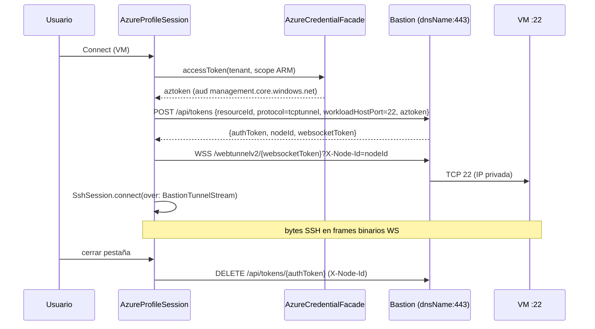

# GH-84 — Investigación: cuentas Azure + SSH/RDP vía Azure Bastion

Fecha: 2026-10-20 · Pedida por el dueño · Estado: **investigación, sin código de producción**.

Código leído como base (solo lectura): `Sources/App/ProfileSession.swift`,
`Sources/App/ProfileCoordinator.swift`, `Sources/AuthKit/{Profiles,KeychainStore,PKCE,LoopbackReceiver,TokenRefresher,CredentialFacade}.swift`,
`Sources/SSHKit/Connect/SshConnector.swift`, `Sources/SSHKit/Session/*`,
`Sources/TunnelKit/{WebSocketTransport,IapListener,RelayStream}.swift`,
`Sources/RDPBridge/{RdpFallbackConnector,WindowsAppLauncher}.swift`,
`Sources/ExplorerUI/ExplorerNode.swift`, `specs/multitenant/*`, `specs/tunnel/transport-decision.md`,
`docs/usage.md` §12 (Sparkle: patrón "secreto fuera del repo, solo en Keychain/secret de CI").

Convención de este documento:

- ✅ **Documentado**: Microsoft Learn / REST reference oficial (URL citada).
- 🔍 **Código fuente oficial, no contrato**: leído en `github.com/Azure/azure-cli-extensions`
  (MIT). Es lo que hace el CLI hoy, pero Microsoft no lo publica como API estable.
- ⚠️ **Inferencia / por validar**: hipótesis nuestra, requiere spike.

---

## 0. Resumen ejecutivo

1. **Auth**: Entra ID con *authorization code + PKCE* y redirect loopback `http://localhost`
   (encaja 1:1 con `AuthorizeURL`/`PKCE`/`LoopbackReceiver` existentes). App registration
   **multi-tenant propia** (no reutilizar el client ID del Azure CLI), *public client*, sin secreto.
   Scope ARM + `offline_access`. Device code solo como fallback opcional: muchas organizaciones
   lo bloquean por Conditional Access y Microsoft recomienda bloquearlo.
2. **Descubrimiento**: ARM REST puro (`/tenants` → `/subscriptions` → VMs/NICs/Bastion hosts),
   paginación por `nextLink`, rol mínimo **Reader**. Resource Graph como optimización.
3. **Bastion**: el *native client* (lo único usable desde una app de escritorio) exige
   **SKU Standard o Premium con `enableTunneling = true`**. Basic no sirve; Developer solo
   desde el portal (y el CLI tiene un camino aparte, no contractual).
4. **Túnel**: `az network bastion tunnel` es **un POST HTTPS a `https://{dnsName}/api/tokens`
   + un WebSocket `wss://{dnsName}/webtunnelv2/{websocketToken}?X-Node-Id={nodeId}` con
   frames binarios = bytes TCP crudos**, sin framing propio (a diferencia del relay IAP).
   Es trivial de implementar en Swift con el `NIOWebSocketTransport` que ya tenemos, **pero
   el protocolo no está documentado** (🔍): riesgo de rotura sin aviso.
5. **Dos caminos de transporte, explícitamente distintos** (§3.7):
   **(a) túnel nativo Swift** reimplementando el protocolo del CLI (no documentado) vs
   **(b) delegar en el `az` instalado por el usuario** (documentado/soportado, requiere Azure CLI).
6. **Limitación crítica de RDP**: el login RDP con **Entra ID vía Bastion no es posible desde
   macOS** — Microsoft solo lo permite con `az network bastion rdp` (Windows-only) y desde PCs
   Windows 10+ unidos/registrados en el mismo directorio (§3.6). Desde Mac: credenciales
   locales/dominio en la VM, o un jump host Windows unido a Entra.
7. **Recomendación**: entregar primero auth + árbol Azure (read-only, 100 % documentado) y
   conexión vía **(b) `az`**; luego **(a)** detrás de feature flag con fallback automático a (b).
   Hay precedente comercial casi idéntico en macOS (TYO Reach, §8): el problema está validado.

Veredicto global: **GO por fases** (detalle en §6.4).

---

## 1. (a) Autenticación Entra ID para app nativa macOS

### 1.1 Authorization code + PKCE vs device code

| | Auth code + PKCE (loopback) | Device code |
|---|---|---|
| Doc | ✅ [v2-oauth2-auth-code-flow](https://learn.microsoft.com/en-us/entra/identity-platform/v2-oauth2-auth-code-flow) | ✅ [v2-oauth2-device-code](https://learn.microsoft.com/en-us/entra/identity-platform/v2-oauth2-device-code) |
| UX | Navegador del sistema, vuelve solo a la app | Copiar código en otra ventana, polling |
| Conditional Access | Normal | Microsoft: *"We recommend organizations get as close as possible to a unilateral block on device code flow"* ✅ [policy-block-authentication-flows](https://learn.microsoft.com/en-us/entra/identity/conditional-access/policy-block-authentication-flows) |
| Reuso en el repo | `PKCE.swift`, `AuthorizeURL.swift`, `LoopbackReceiver.swift`, `LoginSession.swift` | Nada (polling nuevo) |
| Redirect URI | Necesaria (`http://localhost`) | No necesaria |

**Decisión: auth code + PKCE (S256) con loopback**. Device code queda como opción manual
"no puedo abrir navegador" (fase posterior, NO-GO por ahora).

Detalles documentados que afectan al diseño (✅ fuentes arriba y
[reply-url](https://learn.microsoft.com/en-us/entra/identity-platform/reply-url)):

- Endpoints: `https://login.microsoftonline.com/{tenant}/oauth2/v2.0/authorize` y `/token`;
  `{tenant}` ∈ `common | organizations | consumers | <tenant-id>`. Usaremos **`organizations`**
  para el login inicial (las suscripciones Azure viven en tenants de trabajo/escuela) y
  **`<tenant-id>`** para pedir tokens de cada tenant (guest/B2B: *"you must provide the tenant
  identifier to sign them into the resource tenant"*).
- Redirect para apps nativas con navegador del sistema: `http://localhost`. **El puerto se
  ignora en el match** de localhost (RFC 8252 §7.3/§8.3), así que el puerto efímero de
  `LoopbackReceiver` funciona sin registrar N URIs. Microsoft recomienda `127.0.0.1` sobre
  `localhost`, pero para `http://127.0.0.1` hay que editar `replyUrlsWithType` en el manifiesto
  (el portal no lo deja). Registrar **una sola** URI loopback (no varias que difieran solo en puerto).
- Public client: *"Public clients ... must not use secrets or certificates when redeeming an
  authorization code."* → a diferencia del client de Google (que exige `client_secret` en
  Desktop app), en Azure **no hay secreto que custodiar**.
- `response_mode=query` (default para solo `code`); validar `state` (ya lo hace `AuthorizeURL.validate`).

### 1.2 App registration

- Tipo: **Accounts in any organizational directory (multitenant)** (`signInAudience =
  AzureADMultipleOrgs`). Sin cuentas personales MSA (no tienen suscripciones de empresa y además
  cambian reglas de redirect).
- Plataforma: *Mobile and desktop applications* con `http://localhost`;
  *Allow public client flows* = Yes solo si se habilita device code.
- API permission delegada: **Azure Service Management → `user_impersonation`**.
  Todas las operaciones ARM que usamos declaran ese scope (✅ secciones *Security* de cada
  página REST citada en §2).
- Mismo patrón que GCP (`docs/usage.md`, GH-80): **el repo no lleva client ID**; cada usuario
  u organización registra el suyo (o el dueño publica uno para builds oficiales). Un tenant
  con *user consent* deshabilitado requerirá **admin consent** una vez → documentarlo.
- ⚠️ No reutilizar el client ID público del Azure CLI: es una app first-party de Microsoft;
  usarlo desde una app de terceros es suplantación de cliente y puede bloquearse.

### 1.3 Scopes mínimos

```
openid profile offline_access https://management.core.windows.net//user_impersonation
```

- `offline_access` → refresh token (✅: *"Only provided if offline_access scope was requested"*).
- Recurso ARM: el CLI usa **`https://management.core.windows.net//.default`** (doble barra
  intencional) 🔍 [`azure-cli-core/.../auth/util.py#resource_to_scopes`](https://github.com/Azure/azure-cli/blob/dev/src/azure-cli-core/azure/cli/core/auth/util.py)
  + [`cloud.py` `active_directory_resource_id`](https://github.com/Azure/azure-cli/blob/dev/src/azure-cli-core/azure/cli/core/cloud.py).
  ⚠️ En la práctica ARM acepta ambas audiencias (`management.azure.com` y
  `management.core.windows.net`, ambas son identificadores de Azure Service Management),
  pero no encontramos una página que lo garantice. **Bastion valida el `aztoken` que le mandamos; el CLI siempre manda un token con
  audiencia `management.core.windows.net`. Usar exactamente esa audiencia** para no depender
  de que Bastion acepte la otra (validar en el spike F0).

### 1.4 Refresh y varios tenants

- Refresh: `POST /{tenant}/oauth2/v2.0/token` con `grant_type=refresh_token`; **guardar el
  refresh token nuevo que devuelve** (✅: *"Replace the old refresh token with this newly acquired
  refresh token"*). Vida no especificada para nativas → manejar `invalid_grant` /
  `interaction_required` como "requiere Sign In" (igual que `ProfileSession.requiresSignIn`).
- Varios tenants con **una misma cuenta**: tras el login en `organizations`, `GET /tenants`
  lista los tenants del usuario; para cada uno se pide un access token con
  `POST /{tenantId}/oauth2/v2.0/token` + el refresh token. ⚠️ Es lo que hacen MSAL/`az login`
  (multi-resource / cross-tenant refresh); la doc lo enuncia para recursos (*"Refresh tokens are
  valid for all permissions that your client has already received consent for"*), el cruce de
  tenants depende de que la app tenga consentimiento en el tenant destino → si falla con
  `consent_required`/`interaction_required`, interactivo con `{tenant}=<id>` y `login_hint`.
- Caché de access tokens **por (tenantId)** en memoria, 1 h aprox. (`expires_in` 3599).

### 1.5 Varias cuentas a la vez + Keychain aislado

Reutilizar tal cual GH-71/72 (`specs/multitenant/design.md`): **un perfil = una cuenta Azure**
(o una cuenta Google), cada uno con su `ProfileSession`/ventana. Namespacing ya existente:

- Keychain: `ProfileStore.keychainService(for: id, suffix: "azure")` →
  `…profile.<id>.azure`. `ProfileEnvironment.belongs(_:to:)` ya acepta `….profile.<id>.<x>`,
  así que **`purge()` borra también lo de Azure sin cambios** (solo añadir el servicio a
  `knownServices`).
- Cuenta Keychain: `<homeTenantId>:<oid>` (no el UPN: puede cambiar y en B2B es `#EXT#`).
- Guardar solo refresh token + metadatos no sensibles (UPN redactado como hoy
  `ProfileDescriptor.redactedAccount`). Access tokens solo en memoria.
- Alternativa evaluada: **MSAL for iOS/macOS** (`AzureAD/microsoft-authentication-library-for-objc`)
  trae broker/caché/cross-tenant hechos. Contras: dependencia Obj‑C grande, caché propia en
  Keychain con *access group* compartido (choca con el aislamiento por perfil). **Decisión:
  implementación propia sobre AuthKit** (es OAuth estándar; ya tenemos PKCE y loopback).

---

## 2. (b) Descubrimiento ARM REST

Todas con `Authorization: Bearer <token del tenant correcto>`, host `https://management.azure.com`.
Paginación ARM estándar: respuesta `{ "value": [...], "nextLink": "<url absoluta>" }`; seguir
`nextLink` **tal cual** (ya trae `api-version` y `$skiptoken`) hasta que no venga.

| Paso | Request (api-version exacta) | Fuente ✅ |
|---|---|---|
| Tenants | `GET /tenants?api-version=2022-12-01` → `tenantId`, `displayName`, `defaultDomain`, `tenantCategory` (`Home`/`ProjectedBy`/`ManagedBy`) | [tenants/list](https://learn.microsoft.com/en-us/rest/api/resources/tenants/list) |
| Suscripciones | `GET /subscriptions?api-version=2022-12-01` (con token **de ese tenant**) → `subscriptionId`, `tenantId`, `displayName`, `state` | [subscriptions/list](https://learn.microsoft.com/en-us/rest/api/resources/subscriptions/list) |
| Resource groups | `GET /subscriptions/{sub}/resourcegroups?api-version=2021-04-01` (`$filter` por tag, `$top`) | [resource-groups/list](https://learn.microsoft.com/en-us/rest/api/resources/resource-groups/list) |
| VMs (toda la sub) | `GET /subscriptions/{sub}/providers/Microsoft.Compute/virtualMachines?api-version=2026-04-01` (`statusOnly=true` para estado). `osType` en `properties.storageProfile.osDisk.osType`; NICs en `properties.networkProfile.networkInterfaces[].id` | [virtual-machines/list-all](https://learn.microsoft.com/en-us/rest/api/compute/virtual-machines/list-all) |
| Power state | `GET …/virtualMachines/{vm}/instanceView?api-version=2026-04-01` → `statuses[].code == "PowerState/running"` | [virtual-machines/instance-view](https://learn.microsoft.com/en-us/rest/api/compute/virtual-machines/instance-view) |
| NIC (IP privada, subnet→VNet) | `GET …/Microsoft.Network/networkInterfaces/{nic}?api-version=2026-01-01` → `ipConfigurations[].properties.{privateIPAddress, subnet.id}` | [network-interfaces/get](https://learn.microsoft.com/en-us/rest/api/virtualnetwork/network-interfaces/get) |
| Bastion hosts | `GET /subscriptions/{sub}/providers/Microsoft.Network/bastionHosts?api-version=2026-01-01` → `sku.name`, `properties.dnsName`, `enableTunneling`, `enableIpConnect`, `enablePrivateOnlyBastion`, `scaleUnits`, `ipConfigurations[].properties.subnet.id` (Developer: `properties.virtualNetwork.id`) | [bastion-hosts/list](https://learn.microsoft.com/en-us/rest/api/virtualnetwork/bastion-hosts/list) |
| (Opcional, rápido) Resource Graph | `POST /providers/Microsoft.ResourceGraph/resources?api-version=2024-04-01` body `{ "subscriptions": [...], "query": "Resources \| where type =~ 'microsoft.compute/virtualmachines' …" }`, paginación `$skipToken` | [resourcegraph/resources](https://learn.microsoft.com/en-us/rest/api/azureresourcegraph/resourcegraph/resources/resources) |

**Emparejar VM ↔ Bastion** (lógica nuestra): VNet de la VM = prefijo de `subnet.id` de su NIC
hasta `/subnets/`; Bastion candidato = el que vive en esa VNet (prefijo de su
`AzureBastionSubnet`). Bastion en **VNet peered** también alcanza la VM (Basic+; ✅ tabla de
SKUs) → ⚠️ requiere además `GET …/virtualNetworks/{vnet}/virtualNetworkPeerings` (no
verificado en este spike; F1 lo cubre o deja que el usuario elija el Bastion a mano).

### 2.1 RBAC mínimo

✅ [connect-vm-native-client-linux § Required roles](https://learn.microsoft.com/en-us/azure/bastion/connect-vm-native-client-linux):

- **Reader** sobre la VM, **Reader** sobre la NIC con la IP privada, **Reader** sobre el recurso Bastion,
  y **Reader** sobre la VNet de la VM si el Bastion está en una VNet peered
  (✅ [bastion-entra-id-authentication § Assign roles](https://learn.microsoft.com/en-us/azure/bastion/bastion-entra-id-authentication)).
- Solo si se usa login Entra en la VM: **Virtual Machine User Login** o **Virtual Machine Administrator Login**.
- Para descubrimiento basta Reader en sub/RG. Para `run-command` (§4) hace falta
  `Microsoft.Compute/virtualMachines/runCommand/action` (Virtual Machine Contributor o rol custom).

---

## 3. (c) Azure Bastion

### 3.1 SKUs (✅ [bastion-sku-comparison](https://learn.microsoft.com/en-us/azure/bastion/bastion-sku-comparison), [configuration-settings](https://learn.microsoft.com/en-us/azure/bastion/configuration-settings))

| | Developer | Basic | Standard | Premium |
|---|---|---|---|---|
| Subnet `AzureBastionSubnet` /26+ | No | Sí | Sí | Sí |
| IP pública | No | Sí | Sí | No (private-only opcional) |
| **Native client (CLI / nuestra app)** | **No** (portal) | **No** | **Sí** (`enableTunneling`) | **Sí** |
| VNet peering | No | Sí | Sí | Sí |
| Concurrencia | 1 VM a la vez | 40 RDP / 80 SSH (2 inst.) | hasta 1000 RDP / 2000 SSH (50 inst. × 20/40) | ídem |
| Custom port, IP‑connect, file transfer | No | No | Sí | Sí |
| Session recording / private-only | No | No | No | Sí (y recording **no** aplica a native client ✅ [native-client](https://learn.microsoft.com/en-us/azure/bastion/native-client)) |

Consecuencia de producto: la app **solo puede conectar vía Bastion Standard/Premium con
"Native Client Support" activado**. Para Basic/Developer el árbol debe mostrar el Bastion con
el motivo ("SKU sin native client: actualizar a Standard") — mismo comportamiento que el CLI:
🔍 `create_bastion_tunnel` lanza *"Bastion Host SKU must be Standard or Premium and Native Client must be enabled."*

### 3.2 Puertos (corrección al enunciado del issue)

✅ [bastion-nsg](https://learn.microsoft.com/en-us/azure/bastion/bastion-nsg):

- **Cliente → Bastion: solo TCP 443** (`AllowHttpsInbound` desde Internet, o IPs concretas).
  Es lo único que nuestra app necesita salir (igual que IAP: HTTPS + WSS a un host público).
- Bastion → VM: 22 / 3389 (o custom port en Standard+).
- Internos del plano de datos de Bastion: **8080 y 5701** VirtualNetwork↔VirtualNetwork;
  443 a GatewayManager/AzureLoadBalancer/AzureCloud; 80 saliente a Internet.
- **8081 no aparece en la documentación de Bastion** (revisadas NSG, native client, config
  settings) **ni en el código del CLI** (`tunnel.py` solo usa `https://`/`wss://` al puerto por
  defecto 443). El brief del orquestador menciona "443/8081"; lo tratamos como confusión con
  8080 (interno). No afecta al cliente: **solo 443 saliente**.

### 3.2b Matriz oficial de native client (qué comando sirve desde macOS)

✅ [native-client § Connecting to VMs](https://learn.microsoft.com/en-us/azure/bastion/native-client)
+ ✅ [connect-vm-native-client-linux](https://learn.microsoft.com/en-us/azure/bastion/connect-vm-native-client-linux)
+ 🔍 `custom.py` (`_get_ssh_path`: *"Supported platforms: Windows, Darwin, Linux"*;
`_get_rdp_path`: *"Supported platforms: Windows"*):

| Comando | macOS | Entra ID | Sesiones concurrentes | Custom port | Notas |
|---|---|---|---|---|---|
| `az network bastion tunnel` | ✅ | **No** (solo reenvía TCP) | **No** | **No** (según la matriz) | Cualquier cliente nativo (ssh, scp, Windows App) a `127.0.0.1:<port>` |
| `az network bastion ssh --auth-type password\|ssh-key\|AAD` | ✅ (cross-platform) | **Sí** (`AAD`, Linux VM con `AADSSHLoginForLinux`) | Sí | Sí | Lanza el `ssh` del sistema; sin file transfer |
| `az network bastion rdp` | ❌ Windows-only (usa `mstsc`) | Sí (`--enable-mfa`) | Sí | Sí | Inútil en Mac |

Sintaxis exacta del túnel (✅):

```bash
az network bastion tunnel --name "<BastionName>" --resource-group "<ResourceGroupName>" \
  --target-resource-id "<VMResourceId>" --resource-port "<22|3389>" --port "<LocalMachinePort>"
```

IP‑connect (`--target-ip-address` en lugar de `--target-resource-id`): requiere **Standard+**
y activar *IP-based connection*; sin Entra para RDP, sin custom ports
✅ [connect-ip-address](https://learn.microsoft.com/en-us/azure/bastion/connect-ip-address).

### 3.3 Cómo funciona por dentro `az network bastion tunnel` 🔍

Fuente: [`azure-cli-extensions/src/bastion/azext_bastion/tunnel.py`](https://github.com/Azure/azure-cli-extensions/blob/main/src/bastion/azext_bastion/tunnel.py)
y [`custom.py`](https://github.com/Azure/azure-cli-extensions/blob/main/src/bastion/azext_bastion/custom.py)
(extensión `bastion` 1.4.3, [`HISTORY.rst`](https://github.com/Azure/azure-cli-extensions/blob/main/src/bastion/HISTORY.rst)).

1. `GET` del Bastion por ARM (`az network bastion show`) → `sku.name`, `enableTunneling`, `dnsName`.
   Endpoint = `properties.dnsName` (p. ej. `bst-<guid>.bastion.azure.com`).
2. Abre un **socket TCP local** (`localhost`, puerto pedido o 0 = efímero) y por **cada
   conexión aceptada**:
3. **Token de sesión** — `POST https://{dnsName}/api/tokens`, `Content-Type:
   application/x-www-form-urlencoded`, campos:

   | campo | valor |
   |---|---|
   | `resourceId` | ID ARM completo de la VM (o `…/providers/Microsoft.Network/bh-hostConnect/{ip}` en IP‑connect) |
   | `protocol` | `tcptunnel` |
   | `workloadHostPort` | puerto destino (22/3389/custom) |
   | `aztoken` | **access token ARM del usuario** (audiencia `management.core.windows.net`) |
   | `token` | `authToken` de la llamada anterior (vacío la primera vez) |
   | `hostname` | solo IP‑connect: IP destino |

   Header `X-Node-Id: <nodeId>` si ya hay uno. Respuesta 200 JSON:
   `{ "authToken": …, "nodeId": …, "websocketToken": … }`. Error ≠200: JSON con `message`.
4. **WebSocket**: `wss://{dnsName}/webtunnelv2/{websocketToken}?X-Node-Id={nodeId}`
   (Developer/QuickConnect: `wss://{dataPod}/omni/webtunnel/{websocketToken}`, con `dataPod`
   obtenido de `POST https://{dnsName}/api/connection` JSON `{resourceId, bastionResourceId,
   vmPort, azToken, connectionType:"nativeclient"}` — ver
   [`developer_sku_helper.py`](https://github.com/Azure/azure-cli-extensions/blob/main/src/bastion/azext_bastion/developer_sku_helper.py)).
   - **Sin headers de auth en el upgrade, sin subprotocolo**: la autorización va en el path
     (`websocketToken`). TLS con verificación normal. `TCP_NODELAY`.
5. **Framing**: ninguno propio. Cliente→Bastion: `send_binary(bytes)` en trozos de ≤4096;
   Bastion→cliente: cada mensaje recibido se escribe tal cual al socket. Cierre de cualquiera
   de los dos lados cierra el otro. **No hay** ACK/SID/reconexión como en el relay IAP
   (`SshRelayFormat`), ni keepalive aplicativo explícito.
6. **Limpieza**: cuando la última conexión local se cierra →
   `DELETE https://{dnsName}/api/tokens/{authToken}` con `X-Node-Id`; 404 = ya borrada.

Comparación con lo que ya tenemos (`specs/tunnel/transport-decision.md`): el relay IAP exige
headers (`Authorization`, `Origin`), subprotocolo y framing con ACKs; **Bastion es más simple**.
El `NIOWebSocketTransport` actual sirve casi tal cual (quitando headers/subprotocolo) y
`URLSessionWebSocketTask` también bastaría aquí (la razón para descartarlo en IAP — control de
subprotocolo/headers — no aplica), salvo **proxy CONNECT**, donde NIO sigue siendo mejor
→ reutilizar NIO.

### 3.4 ¿Implementable en Swift? Sí — y mejor que el CLI para SSH

- **SSH sin puerto local**: `SshSession.connect(over: SshByteStream, …)` ya acepta cualquier
  stream de bytes. Un `BastionTunnelStream: SshByteStream` (POST token + WSS binario) permite
  SSH **in-process**, igual que hoy con `RelayStream`, sin exponer un puerto en localhost.
  SFTP (`SFTPKit`) funciona encima sin cambios.
- **RDP**: `IapListener.start(streamFactory:)` (listener loopback que ya valida que el cliente
  sea local) + factory que abre un `BastionTunnelStream` por conexión → `.rdp` a
  `127.0.0.1:<puerto>` → Windows App (`RDPBridge` sin cambios). Nota 🔍: `az network bastion rdp`
  **solo funciona en Windows** (`_get_rdp_path` → *"Supported platforms: Windows"*), así que en
  macOS el único camino es tunnel + cliente RDP propio, que es justo lo que hace `RDPBridge`.
- **Qué es inestable** (⚠️): rutas `/api/tokens`, `/webtunnelv2/`, `/omni/webtunnel/`,
  `/api/connection`, nombres de campos y semántica de `X-Node-Id` **no están en Microsoft
  Learn ni en la REST reference**. Han cambiado antes (la extensión pasó por "bug fixes for
  tunnel" en 1.3.0 y 1.4.2). Mitigación: detección de error tipada (`BastionTunnelError.protocolChanged`)
  + **fallback automático al CLI** + test de contrato contra un Bastion real en CI manual.
- Licencia: la extensión es MIT; reimplementar el protocolo (no copiar código) es compatible
  con Apache‑2.0. Citar la fuente en el código.

### 3.5 Fallback pragmático: delegar en el `az` del usuario (contractual)

Lo único **documentado** para clientes no Windows es `az network bastion tunnel` ✅
([native-client § Connecting to VMs](https://learn.microsoft.com/en-us/azure/bastion/native-client)):

```bash
az network bastion tunnel --name <bastion> --resource-group <rg> \
  --target-resource-id <vmResourceId> --resource-port 22 --port <puertoLocal>
```

Diseño del fallback (`AzCliBastionTunnel`):

1. Detectar `az` (`/opt/homebrew/bin/az`, `/usr/local/bin/az`, `PATH` del login shell) y versión
   (`az version -o json`; requisito ✅ CLI ≥ 2.32, file transfer ≥ 2.62). La extensión `bastion`
   se instala sola al primer uso.
2. La sesión del CLI es **la del usuario** (`az login`), no la de nuestro perfil: comprobar con
   `az account show` que el tenant coincide; si no, `--subscription <id>` en el comando.
   El token **nunca** pasa por nuestra app.
3. Elegir puerto libre (bind :0 y soltar), lanzar `Process` con argumentos (sin shell), esperar a
   que el puerto acepte conexión (stdout imprime *"Tunnel is ready, connect on port …"*), conectar:
   - SSH: nuestro `SshSession` sobre un `NWConnection` a `127.0.0.1:<port>` (mismo terminal/SFTP).
   - RDP: `.rdp` → Windows App.
4. Al cerrar la pestaña: `SIGINT` al proceso (el CLI hace `cleanup()` = `DELETE /api/tokens`).
5. Sandbox: la app no está sandboxed hoy (bundle sin firmar, `tools/make-app-bundle.sh`) → `Process` OK.
6. Variante para **SSH con Entra** (única vía documentada desde Mac): `az network bastion ssh
   --auth-type AAD` lanza el `ssh` del sistema, así que no se puede montar sobre nuestro
   `SshSession`; requiere una pestaña de terminal **de proceso local** (SwiftTerm
   `LocalProcessTerminalView`) que ejecute el comando. Sin SFTP integrado en ese modo.

### 3.6 Limitación crítica: RDP con Entra ID desde macOS

✅ [bastion-entra-id-authentication § Limitations](https://learn.microsoft.com/en-us/azure/bastion/bastion-entra-id-authentication):

- *"For native client RDP connections, remote connection to virtual machines joined to Microsoft
  Entra ID is allowed only from Windows 10 or later PCs that are Microsoft Entra registered,
  Microsoft Entra joined, or Microsoft Entra hybrid joined to the same directory as the virtual machine."*
- El único comando native client con Entra para RDP es `az network bastion rdp --enable-mfa`,
  que es Windows-only (§3.2b).
- RDP con Entra **en el portal** (navegador) existe pero está en *public preview* y no es native client.
- El brief del orquestador cita además un Q&A oficial (2026‑03) según el cual el cliente macOS
  no completa NLA/CredSSP con Entra. **No pudimos localizar ese hilo**; el hilo de Q&A de
  2026‑03 encontrado ([answers/a/12645110](https://learn.microsoft.com/answers/a/12645110)) trata
  de la opción Entra oculta en el portal, no de macOS. La conclusión se sostiene igualmente con
  la doc oficial citada arriba.

**Consecuencias de diseño**:

1. RDP desde la app = túnel (a o b) + Windows App con **credenciales locales o de dominio AD**
   de la VM (igual que hoy en GCP con `RDPBridge` + reset de credenciales).
2. Para VMs **solo Entra-joined** sin cuenta local: ofrecer "reset de contraseña local" vía
   extensión VMAccess / `runCommand` (F4) o documentar el jump host Windows unido a Entra.
3. El árbol debe avisar: "Entra RDP no disponible desde macOS" cuando la VM tenga la extensión
   `AADLoginForWindows` (visible en `instanceView.extensions`).
4. SSH con Entra **sí** es posible desde Mac, pero solo vía `az network bastion ssh --auth-type AAD` (§3.5 punto 6).

### 3.7 Dos caminos de transporte: (a) nativo Swift vs (b) `az` delegado

| | **(a) Túnel nativo Swift** | **(b) Delegar en `az` del usuario** |
|---|---|---|
| Base | Reimplementar 🔍 `POST /api/tokens` + `wss://{dnsName}/webtunnelv2/…` (443) | ✅ `az network bastion tunnel` / `ssh` documentados |
| Contrato | **Ninguno**: puede romperse sin aviso | Soportado por Microsoft |
| Requisitos usuario | Ninguno extra | Azure CLI ≥ 2.32 (+ extensión `bastion`, auto) y `az login` **aparte** |
| Identidad | La del perfil de la app (multi-cuenta real, Keychain aislado) | La sesión global de `az` (una "cuenta activa"; choca con multi-perfil, mitigable con `--subscription` y `AZURE_CONFIG_DIR` por perfil ⚠️) |
| SSH | In-process sobre `SshSession` (terminal + SFTP integrados, sin puerto local) | Por puerto local `127.0.0.1` → `SshSession` igualmente (o `ssh` del sistema para Entra) |
| RDP | `IapListener` + Windows App | Puerto del `az` + Windows App |
| Entra SSH | No (requeriría el flujo de certificados `az ssh cert`, no documentado) | **Sí** (`--auth-type AAD`) |
| Entra RDP desde Mac | No (limitación de plataforma, §3.6) | No (igual) |
| Superficie / mantenimiento | ~600–900 LOC + mock server + test de contrato | ~300 LOC (detección, proceso, puertos, errores) |
| UX | Óptima (sin dependencias) | Aceptable (instalar CLI, login doble) |

**Veredictos** (ver plan §6.4):

- **(b) `az` delegado — GO** como primer camino de conexión (F2) y como **fallback permanente**.
- **(a) nativo Swift — GO condicional**: solo si el spike F0 confirma que Bastion acepta tokens
  de nuestra app registration; siempre detrás de flag y con fallback automático a (b) ante
  `protocolChanged`. NO-GO como único camino.

---

## 4. (d) Alternativas

| Opción | Cómo | Pros | Contras | Veredicto |
|---|---|---|---|---|
| **Azure Arc + SSH** ✅ [ssh-arc-overview](https://learn.microsoft.com/en-us/azure/azure-arc/servers/ssh-arc-overview) | Agente Arc (≥1.31) en la máquina, RP `Microsoft.HybridConnectivity`, endpoint `…/providers/Microsoft.HybridConnectivity/endpoints/default?api-version=2023-03-15`, `az ssh arc` | Sin IP pública ni puertos; sin coste de Bastion; RDP sobre SSH | Pensado para **servidores Arc-enabled** (on‑prem/otras nubes), no para VMs Azure nativas; requiere **Owner/Contributor**; proxy de conexión es binario cerrado (`az ssh` descarga un `sshProxy`) | NO-GO ahora (otro producto); reevaluar si el dueño tiene parque Arc |
| **VPN punto a sitio** | VPN Gateway + Azure VPN Client (macOS) | Acceso de red completo, cualquier cliente | Infra aparte, coste fijo (VpnGw1 **$0.19/h** + $0.01/conexión‑h en eastus, Retail Prices API), fuera del alcance de la app | Fuera de alcance: la app funcionaría "directo a IP privada" sin cambios de túnel |
| **`az vm run-command` / REST** ✅ [virtual-machines/run-command](https://learn.microsoft.com/en-us/rest/api/compute/virtual-machines/run-command) | `POST …/virtualMachines/{vm}/runCommand?api-version=2026-04-01` `{commandId: "RunShellScript"\|"RunPowerShellScript", script:[…]}` → 202 + `Location`/`Retry-After` | Sin red hacia la VM; útil para diagnóstico y para **inyectar una llave SSH efímera** (equivalente a "metadata keys" de GCP) | No interactivo, lento (decenas de s), requiere `runCommand/action` | **GO como complemento** (fase 4: "reset credenciales"/llave efímera), no como transporte |
| **Jump host propio** | VM con IP pública + `ProxyJump` | Barato, estándar | Superficie expuesta, gestión de llaves; es justo lo que Bastion evita | Soportable "gratis" si la app admite SSH a IP/host arbitrario (fuera de GH-84) |
| **Microsoft Entra Private Access** ✅ [concept-private-access](https://learn.microsoft.com/en-us/entra/global-secure-access/concept-private-access), [cliente macOS](https://learn.microsoft.com/en-us/entra/global-secure-access/how-to-install-macos-client) | ZTNA de Microsoft (Global Secure Access): cliente en el Mac + *private network connector* en la VNet; Quick Access por FQDN/IP con Conditional Access | Sin IP pública ni Bastion; CA/MFA por app; cliente macOS (macOS 14+) | Licencia Entra Suite/Private Access; el Mac debe estar **registrado en el tenant vía Company Portal**; despliegue MDM; es red, no gestión de VMs | Fuera de alcance; si el cliente lo tiene, la app conecta "directo a IP privada" (modo futuro *Direct*) |
| **Tailscale / NetBird (self-hosted)** — [Tailscale subnet routers](https://tailscale.com/kb/1019/subnets), [NetBird routing](https://docs.netbird.io/how-to/routing-traffic-to-private-networks) | Un nodo *subnet router / routing peer* en la VNet anuncia sus rangos al mesh WireGuard | Muy barato (una VM pequeña), multi-nube, buena UX en Mac | Infra y política propias; NetBird marca *Routes* como deprecado en favor de *Networks*; identidad no ligada a RBAC de Azure | Fuera de alcance; mismo modo *Direct* que VPN/Private Access |

Las cuatro opciones de red (VPN P2S, Private Access, Tailscale/NetBird, jump host) comparten
una conclusión: **no necesitan código de túnel en la app**; bastaría un modo de conexión
"Direct (IP privada alcanzable)" — issue aparte, barato, independiente de Bastion.

---

## 5. (e) Diseño propuesto

### 5.1 Principio

Igual que GH-72: **composición, no reescritura**. Un perfil Azure es otro `ProfileSession`
con su propio grafo de objetos. SSH/SFTP/terminal/RDP se reutilizan; cambia el
*proveedor de identidad*, el *descubrimiento* y el *transporte*.

```mermaid
flowchart TB
  PC[ProfileCoordinator] -->|provider = .gcp| PS[ProfileSession GCP<br/>existente]
  PC -->|provider = .azure| APS[AzureProfileSession<br/>nuevo]

  subgraph AuthKit
    EAuth[EntraAuthorizer<br/>PKCE + LoopbackReceiver]
    ECred[AzureCredentialFacade<br/>refresh por tenant]
    KC[(Keychain<br/>…profile.&lt;id&gt;.azure)]
  end
  APS --> ECred
  ECred --> EAuth
  ECred --> KC

  subgraph AzureClient [AzureClient (nuevo módulo)]
    ARM[ArmClient<br/>paginación nextLink]
    DISC[AzureDiscovery<br/>tenants→subs→VMs/NICs/Bastions]
  end
  APS --> DISC --> ARM

  subgraph BastionKit [BastionKit (nuevo, depende de TunnelKit)]
    BT[BastionTunnelStream<br/>POST /api/tokens + WSS]
    CLI[AzCliBastionTunnel<br/>fallback az]
    SEL[BastionTransportSelector]
  end
  APS --> SEL --> BT
  SEL --> CLI
  BT --> WS[NIOWebSocketTransport<br/>TunnelKit existente]

  APS --> SSH[SshSession / SFTPKit / TerminalUI<br/>existentes]
  SSH -. SshByteStream .-> BT
  APS --> LST[IapListener loopback<br/>existente] --> RDP[RDPBridge → Windows App]
  LST -. streamFactory .-> SEL

  APS --> UI[ExplorerWindowController<br/>dataSourceLabel: Azure]
```

### 5.2 Secuencia de conexión SSH nativa



### 5.3 Bocetos de tipos Swift (no es código de producción)

```swift
// AuthKit — perfil con proveedor (cambio mínimo en ProfileDescriptor, retrocompatible:
// ausencia del campo = .gcp).
public enum CloudProvider: String, Codable, Sendable { case gcp, azure }

public struct EntraClientConfig: Sendable, Equatable {
    public var clientID: String              // app registration propia, sin secreto
    public var authority = URL(string: "https://login.microsoftonline.com")!
    public var loginTenant = "organizations"
    public static let armScope = "https://management.core.windows.net//user_impersonation"
}

/// Credencial persistida (Keychain …profile.<id>.azure). Access tokens solo en memoria.
public struct AzureOfflineCredential: Codable, Sendable {
    public var homeTenantID: String
    public var objectID: String              // oid: clave estable de cuenta
    public var username: String              // UPN, solo para mostrar (redactado en índice)
    public var refreshToken: String
}

public actor AzureCredentialFacade {
    public func signIn(using launcher: LoginSession) async throws -> AzureOfflineCredential
    /// Token ARM para un tenant concreto; refresca y rota el refresh token.
    public func accessToken(tenantID: String) async throws -> String
    public func signOut() async throws
}
```

```swift
// AzureClient — descubrimiento ARM puro, testeable con URLProtocol mock.
public struct AzureVM: Sendable, Hashable, Identifiable {
    public var id: String                    // resource ID ARM
    public var name, resourceGroup, subscriptionID, tenantID, location: String
    public var os: InstanceOS                // reutiliza el enum de ExplorerUI
    public var powerState: String?           // "PowerState/running"
    public var privateIP: String?
    public var vnetID: String?
}

public struct AzureBastion: Sendable, Hashable {
    public enum SKU: String, Sendable { case developer = "Developer", basic = "Basic",
                                         standard = "Standard", premium = "Premium" }
    public var id: String
    public var sku: SKU
    public var dnsName: String
    public var tunnelingEnabled: Bool
    public var vnetID: String?
    public var supportsNativeClient: Bool { (sku == .standard || sku == .premium) && tunnelingEnabled }
}

public struct ArmClient: Sendable {
    public init(token: @escaping @Sendable (_ tenantID: String) async throws -> String)
    /// Sigue `nextLink` hasta agotar; tipado por página `{value, nextLink}`.
    public func list<T: Decodable & Sendable>(_ path: String, apiVersion: String, tenantID: String) async throws -> [T]
}
```

```swift
// BastionKit — transporte.
public struct BastionTarget: Sendable, Hashable {
    public var bastion: AzureBastion
    public var vmResourceID: String
    public var port: UInt16                  // 22 / 3389 / custom
    public var tenantID: String
}

public enum BastionTunnelError: Error, Sendable, Equatable {
    case nativeClientDisabled(sku: String)   // Basic/Developer o enableTunneling=false
    case unauthorized(message: String?)      // 401/403 de /api/tokens (RBAC: Reader VM/NIC/Bastion)
    case protocolChanged(status: Int)        // respuesta inesperada → fallback CLI
    case cliNotFound, cliFailed(exitCode: Int32)
}

/// Implementación nativa (🔍 protocolo no contractual). Conforma SshByteStream.
public actor BastionTunnelStream: SshByteStream {
    public static func connect(to target: BastionTarget,
                               token: @Sendable () async throws -> String,
                               opener: any RelayChannelOpening) async throws -> BastionTunnelStream
    public func close() async               // DELETE /api/tokens/{authToken}
}

/// Elige nativo o CLI; ante `.protocolChanged` cae al CLI y lo recuerda en settings.
public struct BastionTransportSelector: Sendable {
    public enum Mode: String, Sendable { case automatic, nativeOnly, azCLIOnly }
    public func openStream(_ target: BastionTarget) async throws -> any SshByteStream
}
```

```swift
// App — análogo a ProfileSession (mismas responsabilidades de ventana/pestañas).
@MainActor
final class AzureProfileSession: NSObject {
    let id: ProfileID
    let environment: ProfileEnvironment
    let credentials: AzureCredentialFacade
    private lazy var discovery = AzureDiscovery(arm: ArmClient(token: { try await self.credentials.accessToken(tenantID: $0) }))
    private lazy var transports = BastionTransportSelector(/* token, opener, az path */)
    private var sshSessions: [String: SshSession] = [:]       // igual que ProfileSession
    private var terminalTabs: TerminalTabManager?
    func openWindow()                                          // ExplorerWindowController(dataSourceLabel: "Azure")
    func teardown() async                                      // cierra túneles (DELETE tokens) y sesiones
}
```

Para no duplicar `ProfileSession` (622 líneas), F1 debe extraer un protocolo
`ProfileSessionHosting` (ventana, pestañas, cierre, Settings) que ambos implementen;
`ProfileCoordinator` pasa a `ProfileSessionRegistry<any ProfileSessionHosting>`.

### 5.4 Árbol Explorer

Hoy `ExplorerNode` es `cloud → project → zone → instance` (GCP). Propuesta: una ventana por
perfil (REQ-MT-2 sigue igual), así que **una ventana Azure muestra solo el árbol Azure**:

```
Microsoft Azure                (cloud: tenants, VMs)
└─ Contoso (tenant)            (tenant: defaultDomain, categoría)
   └─ Producción (suscripción)
      └─ rg-web (resource group)
         ├─ vm-web-01  🐧 running   Bastion: bst-hub (Standard) ✓
         └─ vm-sql-01  🪟 running   Bastion: — (SKU Basic: sin native client)
```

```swift
public enum ExplorerNode: Hashable, Sendable {
    case cloud(projectCount: Int, instanceCount: Int)
    case project(ProjectInfo)
    case zone(ZoneInfo)
    case instance(InstanceInfo)
    // nuevos (GH-84 F1)
    case azureCloud(tenantCount: Int, vmCount: Int)
    case azureTenant(AzureTenantInfo)
    case azureSubscription(AzureSubscriptionInfo)
    case azureResourceGroup(AzureResourceGroupInfo)
    case azureVM(AzureVMInfo)          // properties: SKU/estado del Bastion asociado
}
```

Menú contextual de `azureVM`: *Connect* (SSH si Linux, RDP si Windows), *Browse files* (SFTP),
*Properties*. Sin "Serial port", "Event log" ni "Inventory" en F1 (equivalentes Azure:
boot diagnostics, Activity Log — fuera de alcance).

### 5.5 Credenciales de la VM (SSH/RDP)

Bastion transporta bytes; **la autenticación SSH/RDP sigue siendo con la VM**:

- F2/F3: llave SSH local del usuario o usuario/contraseña (Keychain por perfil, reutiliza
  `KeychainSettingsStore`), host key TOFU (`InMemoryKnownHosts` → T-SSH-7).
- RDP: usuario/contraseña **local o de dominio AD** en el `.rdp`. **No Entra** desde macOS (§3.6).
- F4 (NO-GO por ahora): login Entra SSH (certificado de `az ssh cert` 🔍, no documentado como
  REST) y llave efímera vía `runCommand` (✅ documentado, pero lento).

---

## 6. (f) Riesgos, costos, límites y plan

### 6.1 Riesgos

| # | Riesgo | Prob. | Impacto | Mitigación |
|---|---|---|---|---|
| R1 | Protocolo `/api/tokens` + `/webtunnelv2` cambia (no documentado 🔍) | Media | Alto (túnel nativo roto) | Fallback automático al `az`; test de contrato manual por release; versión de extensión observada en logs |
| R2 | Bastion rechaza tokens de nuestra app registration (audiencia/appid) ⚠️ | Baja‑media | Bloqueante para nativo | Spike F0 antes de invertir; usar audiencia `management.core.windows.net`; si falla → solo CLI |
| R3 | Clientes con Basic/Developer (sin native client) | Alta | Funcionalidad nula para ellos | Mensaje claro en el árbol; doc de upgrade ✅ [upgrade-sku](https://learn.microsoft.com/en-us/azure/bastion/upgrade-sku) |
| R4 | Tenants con user consent deshabilitado | Alta en empresas | Login falla con `consent_required` | Documentar admin consent URL; mensaje específico |
| R5 | Conditional Access (MFA, device compliance, token protection) | Media | Login/refresh falla | Navegador del sistema (cumple MFA); errores `interaction_required` → re-login; no usar device code |
| R6 | Coste: Bastion cobra por hora desde que existe, no por uso | Cierta | Coste para el dueño/clientes y para nuestras pruebas | Pruebas con despliegue efímero (crear → probar → borrar, ~10 min de deploy) |
| R7 | Peering/hub‑spoke: emparejar VM↔Bastion mal | Media | Botón Connect deshabilitado erróneamente | Selector manual de Bastion por VM, recordado en settings |
| R8 | Duplicación de `ProfileSession` | Media | Deuda | Extraer `ProfileSessionHosting` en F1 |
| R9 | Dependencia del `az` del usuario (fallback) | — | Instalación extra, sesión ajena al perfil | Detección + mensaje "instala con `brew install azure-cli`"; verificar tenant |

### 6.2 Costo por hora de Bastion por SKU

Fuente: **Azure Retail Prices API** (oficial), `serviceName eq 'Azure Bastion'`, región
`eastus`, pay‑as‑you‑go, consultada 2026‑10‑20:
`https://prices.azure.com/api/retail/prices?$filter=serviceName eq 'Azure Bastion' and armRegionName eq 'eastus'`
(la página [pricing](https://azure.microsoft.com/en-us/pricing/details/azure-bastion/) renderiza
los importes por JS).

| SKU | USD/hora (base, 2 instancias) | Instancia adicional | ≈ USD/mes (730 h) | Native client |
|---|---|---|---|---|
| Developer | **gratis** | — | 0 | No |
| Basic | **0.19** | — (fijo 2) | ≈ 138.70 | No |
| Standard | **0.29** | 0.14 | ≈ 211.70 | **Sí** |
| Premium | **0.45** | 0.22 | ≈ 328.50 | **Sí** |

- Datos salientes: primeros **5 GB/mes gratis**, luego ≈ **$0.087/GB** (tramos menores a partir de 10 TB).
- Varía por región: Standard entre **$0.29 y $0.362/h** según la región (misma API, todas las regiones).
- ✅ *"Hourly pricing starts from the moment that Bastion is deployed, regardless of outbound data usage."*
- Coste mínimo realista para usar la app con Bastion: **Standard ≈ $212/mes por VNet hub**
  (un Bastion sirve VMs de VNets peered).

### 6.3 Límites relevantes

- Por instancia: 20 RDP + 40 SSH concurrentes; Standard/Premium 2–50 instancias ✅.
- Developer: 1 VM a la vez, sin peering, regiones limitadas ✅ (y sin native client).
- Native client: sin session recording; IP‑connect sin Entra ni custom port ✅.
- Tunnel: en la tabla oficial "Concurrent VM sessions: No" para `tunnel` ✅ → **un túnel por
  VM**; nuestro diseño abre un `BastionTunnelStream` por pestaña, que es lo correcto.
- Tokens Entra: access ≈ 1 h; el túnel solo usa el `aztoken` al abrir (POST); ⚠️ por validar
  si una sesión WS larga sobrevive a la expiración del token (en el CLI nada lo renueva).

### 6.4 Plan por fases (esfuerzo en días‑persona, 1 dev que conoce el repo)

| Fase | Contenido | Esfuerzo | Depende de | Veredicto |
|---|---|---|---|---|
| **F0 — Spike de validación** | Bastion Standard efímero en suscripción de prueba; app registration multi‑tenant propia; script/CLI de prueba (Swift en `Spikes/`) que haga POST `/api/tokens` + WSS y un `ssh -p` por puerto local. Confirmar R2 (audiencia/appid), cierre, expiración de token. | 2–3 d + ~2–4 h de Bastion (≈ $1) | Suscripción Azure del dueño | **GO** |
| **F1 — Identidad + árbol (read‑only)** | `CloudProvider` en `ProfileDescriptor`; `EntraAuthorizer`/`AzureCredentialFacade` (PKCE, refresh por tenant, Keychain `.azure`); `ArmClient` + `AzureDiscovery`; nodos Azure en `ExplorerNode`; `ProfileSessionHosting`; Properties. 100 % API documentada. | 6–9 d | — (puede ir en paralelo a F0) | **GO** |
| **F2 — Conexión vía (b) `az` (contractual)** | `AzCliBastionTunnel` (detección, puerto, `Process`, ready, SIGINT); SSH (`SshSession` sobre NWConnection loopback) + SFTP; RDP con `RDPBridge` y credenciales locales/dominio (§3.6); credenciales VM en Keychain; mensajes de SKU/RBAC/Entra‑RDP. | 4–5 d | F1 | **GO** — camino recomendado para la primera versión usable |
| **F2b — SSH Entra vía (b)** | Pestaña de terminal de proceso local que ejecuta `az network bastion ssh --auth-type AAD`. | 2–3 d | F2 | **GO condicional** (si el dueño tiene VMs Linux con `AADSSHLoginForLinux`) |
| **F3 — Túnel (a) nativo Swift** | `BastionTunnelStream` (NIO WS sin subprotocolo, binario, DELETE al cerrar), `BastionTransportSelector` con fallback a (b), `IapListener` factory para RDP, tests con mock server (patrón `specs/tunnel/mock-server.md`), feature flag *Settings → Azure → Transporte*. | 6–8 d | F0 positivo + F2 | **GO condicional** (solo si F0 confirma R2; detrás de flag, default `automatic`). **NO-GO como único transporte.** |
| **F4 — Extras** | Device code; login Entra SSH nativo (`az ssh cert`); reset de contraseña local / llave efímera vía `runCommand`/VMAccess; IP‑connect; Developer SKU (`/omni/webtunnel`); Arc; Entra RDP desde Mac. | 8–15 d | F3 | **NO-GO** por ahora (no documentado, bajo valor o imposible en plataforma — Entra RDP); reevaluar con demanda real |

Total hasta F3: **≈ 18–25 días‑persona** (+2–3 d si F2b). Valor entregable desde F2 (≈ 12–17 d).

Recomendación por fase, en una línea:

- **F0**: hacerlo ya; es barato y decide si (a) vale la pena.
- **F1**: hacerlo en paralelo a F0; todo documentado, sin riesgo de protocolo.
- **F2**: entregar con (b) como única vía soportada en la primera versión pública.
- **F2b**: solo si hay demanda de Entra SSH.
- **F3**: solo con F0 en verde; (a) como optimización de UX, nunca sin fallback a (b).
- **F4**: no planificar.

---

## 7. (g) Issues hijos propuestos

1. **GH-84.1 — Spike F0: validar túnel Bastion con token de app registration propia**
   (Spikes/, no producción; criterio: SSH funcional a VM vía WSS nativo, informe de R2/expiración).
2. **GH-84.2 — Spec `specs/azure/{requirements,design,tasks}.md`** (EARS, a partir de este documento).
3. **GH-84.3 — AuthKit: `CloudProvider` en `ProfileDescriptor` + migración retrocompatible**.
4. **GH-84.4 — AuthKit: `EntraAuthorizer` + `AzureCredentialFacade` (PKCE, refresh por tenant, Keychain `.azure`, purge)**.
5. **GH-84.5 — Nuevo módulo `AzureClient`: `ArmClient` (paginación) + `AzureDiscovery` (tenants/subs/RG/VM/NIC/Bastion)** con tests `URLProtocol`.
6. **GH-84.6 — App: extraer `ProfileSessionHosting` de `ProfileSession`; `ProfileCoordinator` multi‑proveedor**.
7. **GH-84.7 — ExplorerUI: nodos Azure (tenant → suscripción → RG → VM) + Properties + estado de Bastion**.
8. **GH-84.8 — BastionKit: `AzCliBastionTunnel` (fallback `az`) + Connect SSH/SFTP/RDP**.
9. **GH-84.9 — BastionKit: `BastionTunnelStream` nativo + `BastionTransportSelector` + mock server** (bloqueado por GH-84.1).
10. **GH-84.10 — Docs: `docs/usage.md` §13 "Azure" (app registration, admin consent, SKU Standard + Native Client, RBAC, costes)**.
11. **GH-84.11 — (Backlog, NO-GO) Entra SSH nativo / llave efímera por `runCommand` / Developer SKU / Arc / Entra RDP desde Mac**.
12. **GH-84.12 — (GO condicional) SSH Entra vía `az network bastion ssh --auth-type AAD` en pestaña de proceso local** (F2b).
13. **GH-84.13 — (Independiente) Modo de conexión "Direct" a IP privada** (sirve para VPN P2S, Entra Private Access, Tailscale/NetBird, jump host).

---

## 8. Herramientas existentes y por qué construimos esto

| Herramienta | Plataforma | Qué hace | Túnel Bastion | Multi-cuenta/tenant | Licencia | Lección para nosotros |
|---|---|---|---|---|---|---|
| **TYO Reach** — [docs Azure Bastion](https://reach.tyo.com.au/docs/remote-targets-azure-bastion) | Win/**macOS**/Linux (desktop) | Login Entra con **app multi-tenant + admin consent una vez por tenant**, auth code + PKCE en navegador (*"device-code sign-in is blocked under Security Defaults"*), abre puerto local vía Bastion **Standard + native client** y lanza RDP/SSH; *"Reach is never in the traffic path"* | Sí | Sí (multi-tenant) | Comercial (plan Team; licencia no publicada) | **Valida exactamente nuestra arquitectura** (auth, SKU, puerto local). Diferencia: no es open source ni parte de un cliente unificado GCP+Azure |
| **Azure Bastion (VS Code)** — [taizod1024.azure-bastion](https://marketplace.visualstudio.com/items?itemName=taizod1024.azure-bastion) | **Windows-only** (PowerShell) | Sidebar suscripciones → VMs alcanzables por Bastion con power state; elegir Bastion si hay varios; Tunnel/SSH/RDP vía `az`; escribe bloque gestionado en `~/.ssh/config` (`# azure-bastion:start/end`) | Sí, vía `az` | Vía auth de VS Code | Extensión de marketplace | Referencia de UX del árbol y del **selector de Bastion**; idea de bloque `~/.ssh/config` gestionado para usar `ssh`/`scp` fuera de la app |
| **AzPin** — [github.com/lfmundim/AzPin](https://github.com/lfmundim/AzPin) | macOS menubar (Swift/SwiftUI) | Lee la sesión de `az`, fija resource groups, abre recursos en el portal, start/stop de App Services/Functions/Container Apps | **No** | La de `az` | MIT | Precedente de app Swift nativa que reusa `az`; no resuelve conectividad |
| **purple** — [github.com/erickochen/purple](https://github.com/erickochen/purple) | macOS/Linux (TUI, Rust) | Gestor de SSH/`~/.ssh/config` que sincroniza hosts de 18 proveedores (incluye Azure), multi-cuenta, ProxyJump, monitoreo de forwards | No documentado | Sí | MIT | Precedente OSS de "inventario multi-nube → SSH"; no cubre Bastion ni RDP |
| **Azure CLI** (`az network bastion …`) | Todas | Referencia oficial | Sí | Una sesión activa | MIT | Es nuestro camino (b) y la fuente del protocolo de (a) |
| **Portal Azure** (Bastion en navegador) | Navegador | RDP/SSH HTML5 | Sí (todas las SKU) | Cambio de directorio manual | — | Funciona en Basic/Developer, pero sin cliente nativo, SFTP ni multi-sesión cómoda |

**Por qué construimos esto** (y no solo recomendamos una herramienta existente):

1. **Paridad con lo que ya existe en la app para GCP**: un único cliente nativo macOS con árbol,
   terminal integrado, SFTP, RDP vía Windows App y **perfiles multi-cuenta aislados por Keychain**.
   Ninguna herramienta abierta ofrece eso para Azure Bastion en macOS.
2. **Open source**: el único equivalente funcional en Mac (TYO Reach) es comercial; la extensión
   de VS Code es Windows-only; AzPin y purple no tunelean por Bastion.
3. **Reutilización alta**: SSHKit, SFTPKit, TerminalUI, RDPBridge, el listener loopback y el
   transporte WebSocket ya existen; el trabajo nuevo es identidad Entra, descubrimiento ARM y
   un adaptador de transporte.
4. **Riesgo acotado**: empezando por (b) `az` dependemos solo de APIs documentadas; (a) es una
   mejora opcional.

Qué **no** aportamos frente a la competencia: Entra RDP desde Mac (imposible por plataforma,
§3.6) ni funcionamiento con Bastion Basic/Developer (limitación de SKU, §3.1).

---

## Fuentes

- Entra: [auth code flow](https://learn.microsoft.com/en-us/entra/identity-platform/v2-oauth2-auth-code-flow) ·
  [device code](https://learn.microsoft.com/en-us/entra/identity-platform/v2-oauth2-device-code) ·
  [redirect URI / localhost](https://learn.microsoft.com/en-us/entra/identity-platform/reply-url) ·
  [CA: bloquear device code](https://learn.microsoft.com/en-us/entra/identity/conditional-access/policy-block-authentication-flows)
- ARM REST: [tenants](https://learn.microsoft.com/en-us/rest/api/resources/tenants/list) ·
  [subscriptions](https://learn.microsoft.com/en-us/rest/api/resources/subscriptions/list) ·
  [resource groups](https://learn.microsoft.com/en-us/rest/api/resources/resource-groups/list) ·
  [VMs list-all](https://learn.microsoft.com/en-us/rest/api/compute/virtual-machines/list-all) ·
  [instance view](https://learn.microsoft.com/en-us/rest/api/compute/virtual-machines/instance-view) ·
  [run command](https://learn.microsoft.com/en-us/rest/api/compute/virtual-machines/run-command) ·
  [network interfaces get](https://learn.microsoft.com/en-us/rest/api/virtualnetwork/network-interfaces/get) ·
  [bastion hosts list](https://learn.microsoft.com/en-us/rest/api/virtualnetwork/bastion-hosts/list) ·
  [Resource Graph](https://learn.microsoft.com/en-us/rest/api/azureresourcegraph/resourcegraph/resources/resources)
- Bastion: [native client](https://learn.microsoft.com/en-us/azure/bastion/native-client) ·
  [connect Linux native client / roles](https://learn.microsoft.com/en-us/azure/bastion/connect-vm-native-client-linux) ·
  [NSG](https://learn.microsoft.com/en-us/azure/bastion/bastion-nsg) ·
  [configuration settings](https://learn.microsoft.com/en-us/azure/bastion/configuration-settings) ·
  [SKU comparison](https://learn.microsoft.com/en-us/azure/bastion/bastion-sku-comparison) ·
  [file transfer native](https://learn.microsoft.com/en-us/azure/bastion/vm-upload-download-native) ·
  [quickstart / Developer](https://learn.microsoft.com/en-us/azure/bastion/quickstart-host-portal) ·
  [pricing](https://azure.microsoft.com/en-us/pricing/details/azure-bastion/) ·
  [Retail Prices API](https://prices.azure.com/api/retail/prices)
- Código CLI (MIT): [bastion/tunnel.py](https://github.com/Azure/azure-cli-extensions/blob/main/src/bastion/azext_bastion/tunnel.py) ·
  [bastion/custom.py](https://github.com/Azure/azure-cli-extensions/blob/main/src/bastion/azext_bastion/custom.py) ·
  [developer_sku_helper.py](https://github.com/Azure/azure-cli-extensions/blob/main/src/bastion/azext_bastion/developer_sku_helper.py) ·
  [azure-cli-core auth/util.py](https://github.com/Azure/azure-cli/blob/dev/src/azure-cli-core/azure/cli/core/auth/util.py)
- Bastion (adicionales): [Entra ID authentication](https://learn.microsoft.com/en-us/azure/bastion/bastion-entra-id-authentication) ·
  [IP-based connection](https://learn.microsoft.com/en-us/azure/bastion/connect-ip-address) ·
  [Q&A 2026-03 opción Entra en portal](https://learn.microsoft.com/answers/a/12645110)
- Alternativas: [Arc SSH](https://learn.microsoft.com/en-us/azure/azure-arc/servers/ssh-arc-overview) ·
  [Entra Private Access](https://learn.microsoft.com/en-us/entra/global-secure-access/concept-private-access) ·
  [GSA client macOS](https://learn.microsoft.com/en-us/entra/global-secure-access/how-to-install-macos-client) ·
  [Tailscale subnet routers](https://tailscale.com/kb/1019/subnets) ·
  [NetBird routing](https://docs.netbird.io/how-to/routing-traffic-to-private-networks)
- Herramientas existentes: [TYO Reach](https://reach.tyo.com.au/docs/remote-targets-azure-bastion) ·
  [VS Code azure-bastion](https://marketplace.visualstudio.com/items?itemName=taizod1024.azure-bastion) ·
  [AzPin](https://github.com/lfmundim/AzPin) · [purple](https://github.com/erickochen/purple)
